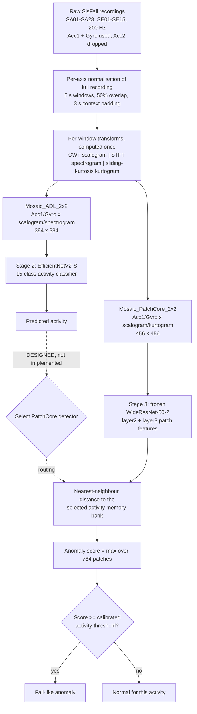
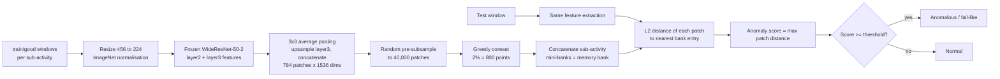

# SisFall-Model: Activity-Aware Fall Detection and Anomaly Scoring from Wearable Sensor Signals

**A three-stage research pipeline that turns waist-worn accelerometer and gyroscope signals into time-frequency mosaic images, recognises the daily activity being performed, and scores each window for fall-like abnormality *relative to that activity*.**

| | |
|---|---|
| **Dataset** | [SisFall](http://sistemic.udea.edu.co/en/research/projects/english-falls/): 38 subjects (23 young adults, 15 elderly), 200 Hz, 19 ADL types, 15 simulated fall types |
| **Stage 1** | Sensor-to-image: CWT scalogram, STFT spectrogram and CWT-based kurtogram packed into two 2 x 2 RGB mosaic formats |
| **Stage 2** | EfficientNetV2-S, 15-class activity classifier: **96.65 %** test accuracy, macro-F1 **0.9562** |
| **Stage 3** | Four activity-specific PatchCore detectors: strong for Walking and Jogging (ROC-AUC > 0.999), **weak for Sitting and Standing_GettingUp** (specificity 3.56 % and 14.04 %) |
| **Status** | Stages 1 to 3 implemented and executed. Stages 2 and 3 were trained and evaluated separately; the routing between them is designed but not implemented |
| **Validation** | Window-wise splits only (every subject appears in both training and evaluation data). Results are **in-distribution**, not evidence of generalisation to unseen people |

> [!IMPORTANT]
> **What is and is not implemented.** Stages 1, 2 and 3 are implemented and were executed; every number in this document is copied from recorded notebook outputs. The **classifier-to-PatchCore routing and a unified fall/no-fall inference step do not exist as runnable code**; they are described only by a commented example at the end of the PatchCore trainer cell. Both models were evaluated with **window-wise splits**. See [Section 10](#10-validation-protocol-and-limitations).

---

## Table of Contents

1. [Project Overview](#1-project-overview)
2. [Project Status](#2-project-status)
3. [The SisFall Dataset](#3-the-sisfall-dataset)
4. [Pipeline Files and Data Flow](#4-pipeline-files-and-data-flow)
5. [End-to-End System Architecture](#5-end-to-end-system-architecture)
6. [Stage 1: Sensor-to-Image Generation](#6-stage-1-sensor-to-image-generation)
7. [Stage 2: EfficientNetV2-S Activity Classification](#7-stage-2-efficientnetv2-s-activity-classification)
8. [Stage 3: Activity-Specific PatchCore Anomaly Detection](#8-stage-3-activity-specific-patchcore-anomaly-detection)
9. [Experimental Results](#9-experimental-results)
10. [Validation Protocol and Limitations](#10-validation-protocol-and-limitations)
11. [References](#11-references)

---

## 1. Project Overview

Fall detection from wearable inertial sensors is usually framed as a single binary classification problem. This pipeline splits it into two questions:

1. **Which activity is this window?** Identify the daily activity a 5-second sensor window belongs to.
2. **Is this window abnormal for that activity?** Compare the window with a memory bank of normal windows from the same activity group, and flag it when its anomaly score reaches an activity-specific, calibrated threshold.

The same signal energy can be routine in one context (jogging) and alarming in another (sitting down). Separating the two questions lets each anomaly detector model a narrower, more homogeneous notion of "normal". The two learning paradigms also fit the data: many well-labelled ADL windows suit a **supervised** classifier, while scarce, simulated and varied falls suit a **one-class** detector that learns only what normal movement looks like.

### 1.1 The three stages

| Stage | Folder | Responsibility | Key technology |
|---|---|---|---|
| 1. Sensor-to-image generation | `Dataset to image generation model/` | Converts raw SisFall `.txt` recordings into two purpose-built RGB mosaic datasets | Morlet CWT, STFT, sliding-window kurtosis, global ADL-only colour bounds |
| 2. Activity classification | `EfficientNetV2-S Model/` | Predicts one of 15 merged daily-activity classes from the ADL mosaic | EfficientNetV2-S, progressive fine-tuning, focal loss, class balancing, EMA/SWA, 3-crop TTA, Grad-CAM |
| 3. Anomaly detection | `PatchCore model/` | Builds four activity-specific one-class detectors from the PatchCore mosaic | Frozen WideResNet-50-2, multi-layer patch embeddings, greedy coreset memory banks, max nearest-neighbour distance, calibrated thresholds, heatmaps |

### 1.2 Headline results

| Model | Result |
|---|---|
| EfficientNetV2-S (2,477 test windows, 3-crop TTA) | Accuracy **96.65 %**, macro-F1 **0.9562**, weighted-F1 **0.9666**, Top-2 **99.64 %**, Top-3 **99.92 %** |
| PatchCore, Walking | Recall 99.86 %, specificity 91.97 %, ROC-AUC 0.9996 |
| PatchCore, Jogging | Recall 100.00 %, specificity 90.14 %, ROC-AUC 0.9992 |
| PatchCore, Sitting | Recall 99.86 %, specificity **3.56 %**, ROC-AUC 0.8072 |
| PatchCore, Standing_GettingUp | Recall 100.00 %, specificity **14.04 %**, ROC-AUC 0.7568 |

High recall alone does not make a detector usable: the Sitting and Standing_GettingUp detectors flag almost every normal window. Full tables are in [Section 9](#9-experimental-results).

---

## 2. Project Status

| Component | Status | Evidence |
|---|---|---|
| Stage 1: dual-mosaic generation script | Implemented | `SisFall_RGB_Mosaic_images_Pipeline.py` |
| Stage 2: EfficientNetV2-S training and evaluation | Implemented, executed, results recorded | Notebook cell outputs |
| Stage 3: organiser, window refiner, four detectors, calibration, evaluation, heatmaps, manual verification | Implemented, executed, results recorded | Notebook cell outputs |
| Classifier-to-PatchCore routing | **Designed only** (commented example, no executable code) | End of PatchCore trainer cell |
| Unified end-to-end inference | **Not implemented** | n/a |
| Anomaly detectors for the other 10 classifier classes | **Not implemented** | Only 4 detector groups exist |
| Subject-independent validation (e.g. LOSO) | **Not performed** | Both splits are window-wise |

---

## 3. The SisFall Dataset

**SisFall** is a public dataset of simulated falls and activities of daily living (ADLs) recorded with a self-developed waist-worn device (two accelerometers and one gyroscope), released by the SISTEMIC research group, Universidad de Antioquia, Colombia.

- Official page: <http://sistemic.udea.edu.co/en/research/projects/english-falls/>
- Dataset paper: Sucerquia, A.; López, J.D.; Vargas-Bonilla, J.F. *SisFall: A Fall and Movement Dataset.* Sensors 2017, 17(1), 198. <https://doi.org/10.3390/s17010198>

### 3.1 Subjects

| Group | Subject IDs | Count | Activities performed (per the dataset paper) |
|---|---|---|---|
| Young adults | `SA01` to `SA23` | 23 | All 19 ADL types and all 15 fall types |
| Elderly | `SE01` to `SE15` | 15 | 14 participants over 62 performed 15 ADL types and no falls; one 60-year-old participant performed all ADLs and falls |
| **Total** | | **38** | |

The generated data are consistent with this: `SE06` is the only elderly subject that appears in fall filenames in the PatchCore logs, and the three smallest classifier classes (D13, D18, D19) each have exactly 360 windows, which equals 24 subjects (23 `SA` + 1 `SE`) x 15 windows. The pipeline enforces the subject-folder pattern `^(SA|SE)\d{2}$`.

### 3.2 Recording format and sensors

Each trial is a plain-text file (one row per sample, nine data columns) sampled at **200 Hz**, named `{code}_{subject}_R{repetition}.txt` (e.g. `D01_SA01_R01.txt`, `F05_SA01_R02.txt`).

| Sensor (SisFall documentation) | Type | Columns | Name in code | Used? |
|---|---|---|---|---|
| ADXL345 | Accelerometer | 0 to 2 (X, Y, Z) | `Acc1` | **Yes** |
| ITG3200 | Gyroscope | 3 to 5 (X, Y, Z) | `Gyro` | **Yes** |
| MMA8451Q | Accelerometer | 6 to 8 (X, Y, Z) | `Acc2` | **No** (deliberately dropped) |

The script maps `Acc1`, `Gyro` and `Acc2` to column triplets 0-2, 3-5 and 6-8; the chip names come from the SisFall documentation, not the script. `Acc2` is excluded because it is a second accelerometer at the same mounting location and is judged redundant with `Acc1`, whereas the gyroscope adds a complementary modality (angular velocity). Dropping it also makes the mosaic a square 2 x 2 grid.

### 3.3 Activity labels

**Activities of Daily Living (D01 to D19)**

| Code | Activity | Code | Activity |
|---|---|---|---|
| D01 | Walking slowly | D11 | Sitting, trying to get up, collapse into chair |
| D02 | Walking quickly | D12 | Sitting, lying down slowly, sit again |
| D03 | Jogging slowly | D13 | Sitting, lying down quickly, sit again |
| D04 | Jogging quickly | D14 | Back and lateral position change |
| D05 | Stairs, slowly | D15 | Standing, bending at knees, getting up |
| D06 | Stairs, quickly | D16 | Standing, bending without knees, getting up |
| D07 | Sit, half-height chair, slowly | D17 | Get into a car, sit, get out |
| D08 | Sit, half-height chair, quickly | D18 | Stumble while walking |
| D09 | Sit, low-height chair, slowly | D19 | Gentle jump to reach an object |
| D10 | Sit, low-height chair, quickly | | |

**Simulated Falls (F01 to F15)** and the PatchCore group each is assigned to in this pipeline:

| Code | Fall type | PatchCore group |
|---|---|---|
| F01 | Forward fall while walking, caused by a slip | Walking |
| F02 | Backward fall while walking, caused by a slip | Walking |
| F03 | Lateral fall while walking, caused by a slip | Walking |
| F04 | Forward fall while walking, caused by a trip | Walking |
| F05 | Forward fall while jogging, caused by a trip | Jogging |
| F06 | Vertical fall while walking, caused by fainting | Walking |
| F07 | Fall while walking with hands on a table, caused by fainting | Walking |
| F08 | Forward fall when trying to get up | Standing_GettingUp |
| F09 | Lateral fall when trying to get up | Standing_GettingUp |
| F10 | Forward fall when trying to sit down | Sitting |
| F11 | Backward fall when trying to sit down | Sitting |
| F12 | Lateral fall when trying to sit down | Sitting |
| F13 | Forward fall while sitting, caused by fainting or falling asleep | Sitting |
| F14 | Backward fall while sitting, caused by fainting or falling asleep | Sitting |
| F15 | Lateral fall while sitting, caused by fainting or falling asleep | Sitting |

The grouping is a manual movement-similarity judgement: each fall is assigned to the activity during which it occurs.

### 3.4 Trial structure observed in the generated data

- Walking and jogging are long single recordings: about 39 windows per subject for D01 and D02, with windows up to `T90.0-95.0s`.
- Most other ADLs are short repeated trials: exactly 15 windows per subject for D11 to D16, D18 and D19.
- Fall trials are about 15 seconds long and yield about 4.9 windows per trial.

### 3.5 Dataset limitations relevant to this pipeline

- **Simulated falls.** All falls were performed by volunteers under laboratory conditions; they are not real-world falls.
- **Young-adult-dominated falls.** Only one elderly participant (`SE06`) performed falls, so the population that most needs fall detection is barely represented in the fall data.

---

## 4. Pipeline Files and Data Flow

### 4.1 Code files

```text
SisFall-Model/
├── README.md
├── Dataset to image generation model/
│   └── SisFall_RGB_Mosaic_images_Pipeline.py              # Stage 1: raw SisFall -> Mosaic_ADL_2x2 + Mosaic_PatchCore_2x2
├── EfficientNetV2-S Model/
│   └── sisfall-efficientnetv2-s-train2-advanced2.ipynb    # Stage 2: cell 0 discovery, cell 1 full training/evaluation script
└── PatchCore model/
    └── sisfall-patchcore-train5.ipynb                     # Stage 3: 6 cells (discovery, organiser, refiner, trainer, heatmaps, verification)
```

### 4.2 Data produced by each stage

```text
<project_root>/
├── SisFall_dataset/                              # INPUT: raw SisFall data
│   ├── SA01/ ... SA23/                           #   *.txt trials
│   └── SE01/ ... SE15/
│
└── Generated_Images_Mosaic/                      # STAGE 1 OUTPUT
    ├── Mosaic_ADL_2x2/                           #   384 x 384 mosaics -> Stage 2
    │   ├── Daily Living/{activity}/{subject}/{stem}.png   # e.g. Walking_Slow/SA01/D01_SA01_R01_T0.0-5.0s.png
    │   └── Fall/{subject}/{stem}.png                       # e.g. SA01/F05_SA01_R02_T5.0-10.0s.png
    └── Mosaic_PatchCore_2x2/                     #   456 x 456 mosaics -> Stage 3
        ├── Daily Living/{activity}/{subject}/{stem}.png
        └── Fall/{subject}/{stem}.png
```

`{activity}` is the folder name from `ACTIVITY_LABELS` (e.g. `Walking_Slow`, `Sit_HalfHeight_Fast`, `Collapse_Into_Chair`). Window filenames follow `{trial}_T{t0:.1f}-{t1:.1f}s.png`; the time suffix is omitted when a recording yields only one window.

**Stage 3 working structure** (built inside the notebook's working directory):

```text
PatchCore_Ready/                                  # built by cell 1 (copies), modified by cell 2 (moves)
└── {Walking | Jogging | Sitting | Standing_GettingUp}/
    ├── train/good/{sub_activity}/*.png           # normal windows for the memory bank, one folder per source ADL
    └── test/
        ├── good/*.png                            # held-out normal ADL windows
        ├── anomaly/*.png                         # refined fall windows (top-2 kurtogram intensity per trial)
        ├── prefall_context/*.png                 # early windows from fall trials, treated as normal
        └── anomaly_excluded_ambiguous_postfall/  # set aside (moved, not deleted)

patchcore_models/                                 # cell 3: memory_bank_{Activity}.pt, analysis plots, patchcore_summary.csv
heatmap_visualizations/                           # cell 4: overview grids, 15-image individual test suite
manual_verification/                              # cell 5: window-selection spot checks
```

---

## 5. End-to-End System Architecture



### 5.1 How the stages relate

1. **Stage 1** is a shared front end. Both mosaics come from the *same* per-window CWT/STFT/kurtosis computation; they differ only in which representations fill the columns and in the final cell size.
2. **Stage 2** consumes `Mosaic_ADL_2x2` (scalogram + spectrogram), chosen for activity identification.
3. **Stage 3** consumes `Mosaic_PatchCore_2x2` (scalogram + kurtogram). The kurtogram is included to expose impulsive events such as impacts.
4. Stages 2 and 3 depend only on Stage 1 and were **trained and evaluated independently** of each other.

### 5.2 Intended inference workflow (design only)

The PatchCore trainer cell ends with a commented conceptual pipeline for a new 5-second window:

1. Generate both mosaics for the window from the same raw sensor slice.
2. Run the classifier on `Mosaic_ADL_2x2` to obtain the predicted activity.
3. Map the activity to a PatchCore group (table below).
4. Load `memory_bank_{group}.pt` and score the window's `Mosaic_PatchCore_2x2` image.
5. Compare the score with that group's calibrated threshold from `patchcore_summary.csv`.

| Classifier output class | PatchCore detector |
|---|---|
| `Walking_Slow`, `Walking_Fast` | Walking |
| `Jogging` | Jogging |
| `Sitting` | Sitting |
| `Collapse_Into_Chair` | Standing_GettingUp |
| `Stairs_Slow`, `Stairs_Fast`, `Lying_Slow_SitAgain`, `Lying_Fast_SitAgain`, `Back_Lateral_Change`, `Standing_KneeBend`, `Standing_NoKneeBend`, `Car_InOut`, `Stumble_Walking`, `Gentle_Jump` (10 classes) | **No detector; fallback policy undefined** |

The comment lists possible fallbacks (route to the nearest available group, or flag the window as an "unmonitored activity") but does not choose one.

---

## 6. Stage 1: Sensor-to-Image Generation

**File:** `Dataset to image generation model/SisFall_RGB_Mosaic_images_Pipeline.py`

### 6.1 Processing pipeline

| Step | Implementation |
|---|---|
| Input parsing | `read_df` tries three delimiter configurations, strips trailing semicolons and drops all-empty columns; files with fewer than 9 columns are skipped |
| Channels | `Acc1` (cols 0-2) and `Gyro` (cols 3-5). `Acc2` (cols 6-8) is defined but not processed (`MOSAIC_ROW_DEVICES = ['Acc1', 'Gyro']`) |
| Sampling rate | `FS = 200.0` Hz |
| Normalisation | Each axis of the **full recording** is zero-meaned and peak-normalised to [-1, +1] **once**, not per window |
| Windowing | `SPLIT_WINDOW_S = 5.0` s, `SPLIT_OVERLAP = 0.5` (hop 2.5 s); **only full-length windows** are emitted |
| Context handling | `CONTEXT_S = 3.0`: each window is transformed with up to 3 s of extra signal on each side (limited by the recording edges) and then cropped to the window, removing CWT/STFT edge artefacts |
| Transforms | CWT, STFT and kurtosis map, computed once per device per window and reused by both mosaics |
| Rendering | Each single-axis map is drawn with matplotlib (8 x 4.5 in, 150 dpi, no axes), captured in memory, resized (LANCZOS) to 224 x 224 and converted to **grayscale** (ITU-R BT.601 luma) |
| Channel packing | The X, Y and Z axis maps of a device become the **R, G and B** channels of one 224 x 224 cell |
| Mosaic assembly | Cells are resized (LANCZOS) to the variant's cell size and pasted into a 2 x 2 grid with 8 px black gutters |
| Output | Only the two mosaic variants are saved (`SAVE_INDIVIDUAL_REPRESENTATIONS = False`) |

> [!NOTE]
> **About "RGB".** A cell is not a colour-mapped picture. The colour map is applied only to render each single-axis map, which is then reduced to grayscale; R, G and B carry the X, Y and Z axes. Colour maps matter only through their **luminance ordering**, which is why monotonic-luminance maps (`viridis`, `inferno`, `cividis`) were chosen.

### 6.2 Time-frequency representations

| Representation | Method | Parameters | Colour map | What it conveys |
|---|---|---|---|---|
| **Scalogram** | CWT magnitude (`pywt.cwt`) | Morlet (`morl`), scales 1 to 128, `sampling_period = 1/FS` | `viridis` | Multi-scale time-frequency energy; resolves both periodic gait cycles and short impacts. Small scales correspond to high frequencies |
| **Spectrogram** | STFT power in dB (`scipy.signal.spectrogram`) | Hann, `nperseg=256`, `noverlap=128`, `nfft=256`, `scaling='spectrum'`, `10·log10(S + 1e-12)`; displayed 0 to 100 Hz | `inferno` | Frequency content at a fixed resolution (256 samples = 1.28 s); shows cadence bands of rhythmic activities |
| **Kurtogram** | Sliding-window **excess kurtosis** (bias-corrected) of the CWT magnitude along time, per scale | Window 128 samples (0.64 s), step 64 (0.32 s); `scales[8:]` only (`KURT_MIN_SCALE_IDX = 8`) | `cividis` | **Impulsiveness**: near 0 for steady segments, strongly positive for sudden impacts, negative for very regular segments |

> [!NOTE]
> **Terminology.** The "kurtogram" here is a custom CWT-based sliding-kurtosis map. It is **not** the fast kurtogram of Antoni (2007), which is cited only as background.

**Why the eight highest-frequency scales are excluded from the kurtogram ("FIX A" in the code).** Scales 1 to 8 are noise-dominated and previously rendered as a flat bright band that consumed luminance range. Excluding them returns that range to the mid/low scales where fall-related impulsiveness appears. The scalogram and spectrogram keep their full ranges.

**Scale invariance.** Kurtosis is invariant to positive rescaling, so the kurtogram is unaffected by the per-recording peak normalisation.

### 6.3 Global colour bounds

Intensities are mapped with **global** `(vmin, vmax)` bounds so brightness is comparable across all images. The bound scan uses **ADL files only** (never falls) and only `Acc1` and `Gyro`: per-file 1st/99th percentiles are aggregated with the 2nd/98th percentile across files, and the kurtogram range is made symmetric around zero. A genuine fall therefore saturates against a scale calibrated on normal activity, whereas per-image min/max scaling would hide how energetic an image is.

With `USE_HARDCODED_BOUNDS = True` (the setting in the script) the scan is skipped and these values are used:

| Representation | vmin | vmax |
|---|---|---|
| Scalogram | 3.7879e-05 | 3.6433 |
| Spectrogram (dB) | -110.91 | -16.12 |
| Kurtogram | -7.1396 | +7.1396 |

Running the script with `--bounds-only` re-scans the ADL files and prints fresh bounds; they must be recomputed whenever the CWT scales, STFT settings, kurtogram scale range or device set change.

### 6.4 The two mosaic variants

```text
          Mosaic_ADL_2x2 (384 x 384)                 Mosaic_PatchCore_2x2 (456 x 456)
   ┌──────────────────┬──────────────────┐     ┌──────────────────┬──────────────────┐
   │ Acc1  scalogram  │ Acc1 spectrogram │     │ Acc1  scalogram  │ Acc1  kurtogram  │
   │    188 x 188     │    188 x 188     │     │    224 x 224     │    224 x 224     │
   ├──────────────────┼──────────────────┤     ├──────────────────┼──────────────────┤
   │ Gyro  scalogram  │ Gyro spectrogram │     │ Gyro  scalogram  │ Gyro  kurtogram  │
   └──────────────────┴──────────────────┘     └──────────────────┴──────────────────┘
       8 px black gutters; each cell: R = X axis, G = Y axis, B = Z axis
```

| Property | `Mosaic_ADL_2x2` | `Mosaic_PatchCore_2x2` |
|---|---|---|
| Rows | Acc1, Gyro | Acc1, Gyro |
| Columns | scalogram, spectrogram | scalogram, kurtogram |
| Cell size | **188 x 188** px | **224 x 224** px |
| Canvas | **384 x 384** px (2·188 + 8) | **456 x 456** px (2·224 + 8) |
| Purpose | Activity identification | Anomaly / fall detection |
| Consumer | EfficientNetV2-S (Stage 2) | PatchCore (Stage 3) |

Each representation is rendered and cached once at 224 x 224; each variant then performs only a cheap final resize. The ADL canvas is square, so resizing to a square network input does not distort the aspect ratio. Fall files are identified by a filename starting with `F`, ADLs by `D`.

### 6.5 Computational notes

- Per window: 2 devices x 3 axes x 3 representations = **18 matplotlib renders**; dropping `Acc2` saves nine per window.
- The kurtogram reuses the CWT magnitudes already computed for the scalogram.
- The stage is CPU-bound (matplotlib, PyWavelets, SciPy).

---

## 7. Stage 2: EfficientNetV2-S Activity Classification

**File:** `EfficientNetV2-S Model/sisfall-efficientnetv2-s-train2-advanced2.ipynb`

### 7.1 Task, data and labels

- **Task:** supervised 15-class activity classification of a 5-second window.
- **Input:** `Mosaic_ADL_2x2` images at 384 x 384, ImageNet mean/std normalisation.
- **Data in the recorded run:** 16,437 windows from 38 subjects.
- **Class merging:** the 19 D-codes become **15** classes through two merges, `D03+D04 -> Jogging` and `D07+D08+D09+D10 -> Sitting`, motivated by slow/fast variants the model confused. All other codes stay separate; `Standing_KneeBend` is deliberately kept as its own class so its confusion with Sitting stays visible.

| Class | Source codes | Images | Train | Val | Test |
|---|---|---|---|---|---|
| Walking_Slow | D01 | 1,476 | 1,033 | 221 | 222 |
| Walking_Fast | D02 | 1,508 | 1,055 | 226 | 227 |
| Jogging | D03 + D04 | 2,942 | 2,059 | 441 | 442 |
| Stairs_Slow | D05 | 1,685 | 1,179 | 252 | 254 |
| Stairs_Fast | D06 | 1,041 | 728 | 156 | 157 |
| Sitting | D07 to D10 | 2,250 | 1,575 | 337 | 338 |
| Collapse_Into_Chair | D11 | 569 | 398 | 85 | 86 |
| Lying_Slow_SitAgain | D12 | 570 | 399 | 85 | 86 |
| Lying_Fast_SitAgain | D13 | 360 | 251 | 54 | 55 |
| Back_Lateral_Change | D14 | 570 | 399 | 85 | 86 |
| Standing_KneeBend | D15 | 570 | 399 | 85 | 86 |
| Standing_NoKneeBend | D16 | 569 | 398 | 85 | 86 |
| Car_InOut | D17 | 1,607 | 1,124 | 241 | 242 |
| Stumble_Walking | D18 | 360 | 251 | 54 | 55 |
| Gentle_Jump | D19 | 360 | 251 | 54 | 55 |
| **Total** | | **16,437** | **11,499** | **2,461** | **2,477** |

Class sizes range from 360 to 2,942 windows (about 8 : 1).

### 7.2 Split methodology

`window_wise_split` shuffles **each class independently at the image level** (seed 42). Per class, `floor(70 %)` of windows go to training, `floor(15 %)` to validation and the remainder to test. **All 38 subjects contribute to all three partitions**, so this is not a subject-independent split ([Section 10](#10-validation-protocol-and-limitations)).

### 7.3 Model and training recipe

| Item | Setting |
|---|---|
| Architecture | `torchvision.models.efficientnet_v2_s`, weights `EfficientNet_V2_S_Weights.IMAGENET1K_V1` (unmodified Fused-MBConv / MBConv backbone) |
| Classifier head | `model.classifier[1]` replaced by `nn.Linear(in_features, 15)`; the preceding dropout layer is kept |
| Weight loading | 3-attempt retry loop that removes corrupted cache files; falls back to random initialisation with a warning if all attempts fail (the recorded run loaded the pretrained weights on the first attempt) |
| Loss | Custom **focal loss** (`gamma = 2.0`) on cross-entropy with **label smoothing 0.15** and softened class weights |
| Class weights | `(1/count)^0.5`, normalised to sum to the number of classes (`ALPHA = 0.5`) |
| Sampling | `WeightedRandomSampler`, per-sample weight `1/count` of its class, `replacement=True` |
| Optimiser | AdamW, `weight_decay = 2e-4` |
| Batch size / seed | 32 / 42 |
| Augmentation (train only) | `RandomResizedCrop(384, scale=(0.90, 1.0), ratio=(1.0, 1.0))` and `RandomErasing(p=0.2, scale=(0.02, 0.06), ratio=(0.5, 2.0))`. **No flips, rotations or colour jitter** |
| EMA | Decay 0.999 (`get_ema_avg_fn`, with a manual fallback for older PyTorch), updated after every optimiser step in stages B and C |
| SWA | `AveragedModel` + `SWALR` (`swa_lr = 1e-5`), SGD (lr 1e-5, momentum 0.9, weight decay 2e-4), 8 epochs, then `update_bn` |
| Early stopping | Patience 8 epochs per stage, reset whenever raw or EMA validation accuracy improves; **never triggered** in the recorded run |

**Progressive fine-tuning schedule (63 epochs in total)**

| Stage | Trainable parts | Learning rate(s) | Epochs | Scheduler |
|---|---|---|---|---|
| A: head only | Classifier | 1e-3 | 10 | None |
| B: last 3 | Last 3 child modules of `model.features` + classifier | features 1e-5, classifier 1e-4 | 30 | Cosine (T_max 30) |
| C: last 6 | Last 6 child modules of `model.features` + classifier | features 3e-6, classifier 3e-5 | 15 | Cosine (T_max 15) |
| D: SWA | Same as stage C (the optimiser receives all parameters, but the earlier blocks stay frozen) | SGD 1e-5 | 8 | SWALR |

**Checkpoint selection.** Raw, EMA and SWA checkpoints are saved and the one with the highest **validation** accuracy is used for testing. Recorded: raw 96.67 % (epoch 55), EMA 96.63 %, SWA 96.67 %. The raw checkpoint was selected (on a tie, the first candidate, raw, wins), so EMA and SWA gave no measurable gain in this run.

### 7.4 Training trajectory (recorded)

| Point | Validation accuracy | Validation macro-F1 |
|---|---|---|
| End of stage A (epoch 10) | 72.90 % | 0.6741 |
| First epoch of stage B (epoch 11) | 80.82 % | 0.7735 |
| End of stage C (epoch 55, selected checkpoint) | 96.67 % | 0.9564 |

The largest jump comes at the first unfreezing. At epoch 55, training accuracy was 98.66 % against 96.67 % validation.

### 7.5 Evaluation protocol

- **3-crop test-time augmentation (TTA):** the full image, a 95 % centre crop and a 90 % centre crop, each resized to 384 x 384; softmax probabilities are averaged before `argmax`.
- **Metrics:** classification report, raw and row-normalised confusion matrices, per-class TP/TN/FP/FN, precision, recall, specificity, F1, Top-2 and Top-3 accuracy.
- **Weak-group analysis:** a sub-confusion matrix and bar chart for eight sit/stand/lying/car classes (`Sitting`, `Collapse_Into_Chair`, both `Lying` classes, `Back_Lateral_Change`, both `Standing` classes, `Car_InOut`).
- **Grad-CAM:** written from scratch with forward/backward hooks on `features[-1][0]` (the final 1 x 1 convolution), run on four random weak-group test samples (without TTA) with the *true* class as target, to check that attention falls on signal content rather than gutters or borders.

### 7.6 Design rationale

| Technique | Why it is used here |
|---|---|
| ImageNet transfer learning | Small dataset relative to model size; pretrained edge and texture detectors transfer to time-frequency images |
| Progressive unfreezing with lower backbone learning rates | Adapts the new head first and protects pretrained features |
| AdamW weight decay | Counters the train/validation gap |
| Focal loss + label smoothing | Concentrates learning on ambiguous sit/stand/lying classes and reduces over-confidence between near-identical classes |
| Softened class weights + weighted sampler | Two complementary corrections for the 8 : 1 class imbalance |
| Restricted augmentation | Flips, rotations or colour jitter would create physically impossible signals or break the intensity encoding |
| EMA / SWA | Candidate smoother weights, compared with raw weights on validation |
| 3-crop TTA | Small robustness gain at inference (not ablated) |
| Grad-CAM | Qualitative check of where the model looks |

---

## 8. Stage 3: Activity-Specific PatchCore Anomaly Detection

**File:** `PatchCore model/sisfall-patchcore-train5.ipynb` (six code cells, run in order)

| Cell | Role |
|---|---|
| 0 | Discovers the dataset folders |
| 1 | **Dataset organiser:** builds `PatchCore_Ready/` per activity group (copies files; the source mosaics are untouched) |
| 2 | **Anomaly window refiner:** labels fall windows as anomaly / pre-fall context / excluded (moves files; must run exactly once) |
| 3 | **PatchCore trainer and evaluator:** memory banks, threshold calibration, metrics |
| 4 | **Heatmap visualisation:** overview grids (8 normal + 8 fall samples) and a 15-image-per-detector individual test suite |
| 5 | **Manual verification:** visual spot-checks of the window-selection heuristic (8 trials per detector) |

### 8.1 Why PatchCore, and why activity-specific

- **One-class suitability.** Labelled falls are scarce, simulated and risky to collect from the people who most need protection. PatchCore needs **no gradient training, loss function or anomalous training examples**: its memory bank is built from normal ADL windows only.
- **Localisation.** Per-patch distances give an anomaly heatmap, an interpretability a single scalar classifier lacks.
- **Activity-specific detectors.** Jogging-level motion would look abnormal for sitting. A single global bank must cover every normal pattern and becomes permissive; per-activity banks model a narrower "normal" and allow a per-activity threshold.

### 8.2 The four detectors and their data

| Detector | Normal (ADL) source folders | Fall codes treated as anomalies |
|---|---|---|
| **Walking** | `Walking_Slow`, `Walking_Fast` (D01, D02) | F01, F02, F03, F04, F06, F07 |
| **Jogging** | `Jogging_Slow`, `Jogging_Fast` (D03, D04) | F05 |
| **Sitting** | `Sit_HalfHeight_Slow/Fast`, `Sit_LowHeight_Slow/Fast` (D07 to D10) | F10 to F15 |
| **Standing_GettingUp** | `Collapse_Into_Chair` (D11 only) | F08, F09 |

The Standing_GettingUp detector's *normal* data comes **only from D11**, the closest available ADL to a get-up motion; D15 and D16 are not used.

**Dataset sizes (recorded run)**

| Detector | train/good | test/good | Fall windows before refinement (trials) | Kept anomaly | Pre-fall context | Excluded |
|---|---|---|---|---|---|---|
| Walking | 2,387 | 597 | 3,529 (719) | 1,438 (40.7 %) | 650 (18.4 %) | 1,441 (40.8 %) |
| Jogging | 2,354 | 588 | 596 (120) | 240 (40.3 %) | 26 (4.4 %) | 330 (55.4 %) |
| Sitting | 1,800 | 450 | 3,555 (719) | 1,438 (40.5 %) | 119 (3.3 %) | 1,998 (56.2 %) |
| Standing_GettingUp | 455 | 114 | 1,188 (240) | 480 (40.4 %) | 50 (4.2 %) | 658 (55.4 %) |

**Normal training windows per sub-activity:** Walking_Fast 1,204 / Walking_Slow 1,183; Jogging_Fast 1,141 / Jogging_Slow 1,213; Sit_HalfHeight_Fast 462 / Sit_HalfHeight_Slow 456 / Sit_LowHeight_Fast 441 / Sit_LowHeight_Slow 441; Collapse_Into_Chair 455.

Normal windows are split **80 % train / 20 % test** (`TRAIN_GOOD_FRACTION = 0.80`) at the image level (`window_wise_good_split`, seed 42). All 38 subjects appear in both `train/good` and `test/good` for Walking, Jogging and Sitting; for Standing_GettingUp, 38 appear in `train/good` and 34 in `test/good`. All fall windows go to `test/anomaly`, since no fall data is used to build memory banks.

### 8.3 Fall-window refinement (heuristic)

A 15-second fall trial yields about five overlapping windows, but only one or two contain the impact. Labelling all of them as anomalies would mark calm pre- and post-fall windows as falls and drag the threshold down. For each trial, the refiner:

1. Scores each window by the **standard deviation of pixel values in the kurtogram column** of the mosaic (x = 232 to 456, both rows), as a proxy for impulsiveness.
2. Keeps the **two highest-scoring windows** (`TOP_K_WINDOWS_PER_TRIAL = 2`) as `test/anomaly`.
3. Orders the windows in time. The window immediately before the earliest kept window is an ambiguous buffer (`PREFALL_BUFFER_WINDOWS = 1`); windows **at least two positions** before it go to `test/prefall_context` and are treated as normal.
4. Moves the buffer and all other remaining windows (between or after the kept windows) to `test/anomaly_excluded_ambiguous_postfall`, where they are not used.

> [!WARNING]
> This is an **unsupervised image-intensity heuristic, not ground-truth impact annotation**. Because the detector later scores images that contain the same kurtogram, held-out recall is partly built into the labelling ([Section 10.2](#102-sources-of-potential-leakage)).

### 8.4 PatchCore workflow



1. **Preprocessing.** Each 456 x 456 mosaic is resized to 224 x 224 (`PATCHCORE_IMG_SIZE`) and ImageNet-normalised, which halves the spatial detail.
2. **Frozen backbone.** `wide_resnet50_2` with `IMAGENET1K_V1` weights in eval mode; all parameters `requires_grad = False`. Forward hooks capture `layer2` (512 channels, 28 x 28) and `layer3` (1,024 channels, 14 x 14).
3. **Patch embeddings.** Each map is smoothed with a 3 x 3 average pool (stride 1, padding 1); `layer3` is bilinearly upsampled to 28 x 28; concatenation gives **1,536-dimensional** vectors, **784 per image**.
4. **Pre-subsampling.** Each sub-activity yields between 345,744 and 950,992 raw patches; they are uniformly subsampled without replacement to `RAW_PATCH_SUBSAMPLE_CAP = 40,000`. The code comment records the reason: an earlier setting (150,000 patches, 15,000-point target) was benchmarked at about 2.6 s per greedy iteration on CPU, extrapolated to about 11 hours per activity.
5. **Greedy coreset (farthest-point / k-center).** Starting from the first patch, the algorithm repeatedly adds the patch farthest from the selected set, maintaining running minimum distances with `torch.cdist`. Target = `min(2 % of patches, 2,000)`; after pre-subsampling this is **800 points per sub-activity**, so the 2,000 cap is never reached. The result is a true subset of real patches.
6. **Sub-activity balancing.** One 800-point mini-bank is built per original sub-activity and the banks are concatenated, so each sub-activity is represented equally. This was added to address low specificity; for a single-source group it changes nothing.

| Detector | Sub-activity banks | Final memory-bank size |
|---|---|---|
| Walking | 2 x 800 | 1,600 |
| Jogging | 2 x 800 | 1,600 |
| Sitting | 4 x 800 | 3,200 |
| Standing_GettingUp | 1 x 800 | 800 |

7. **Scoring.** For each test image, every patch's L2 distance to its **nearest** bank entry is computed; the **maximum** over the 784 patches is the image score. This is sensitive to brief, localised events, but a single unusual patch can also trigger a false alarm.
8. **Heatmaps.** The 28 x 28 nearest-neighbour distance map is bilinearly upsampled to 224 x 224 and overlaid with the `jet` colour map (alpha 0.45); the hottest pixel is circled in white and labelled with its mosaic quadrant.

**Differences from the original PatchCore paper.** This is a simplified variant: it omits the paper's random-projection acceleration of the coreset search and its re-weighting of the image-level score, and it adds the 40,000-patch pre-subsampling for tractability.

### 8.5 Threshold calibration and evaluation split

For each detector, `test/good` and `test/anomaly` are **each shuffled and split in half** (`CALIBRATION_FRACTION = 0.5`, seed 42; the calibration half gets `floor(n/2)` and the held-out half the rest):

- **Calibration half:** used only to choose the threshold, set to the **minimum anomaly score among calibration fall windows**. Calibration recall is therefore 100 % by construction.
- **Final held-out half:** used to report recall, specificity and FPR; the threshold never sees it.

Reported metrics:

| Metric | Definition in the code |
|---|---|
| Recall | Share of held-out fall windows with score ≥ threshold |
| Specificity / FPR | Share of held-out normal windows below / at or above the threshold |
| Trial-level recall | Share of fall trials whose highest held-out window score is ≥ threshold |
| Pre-fall-context specificity | Share of all `prefall_context` windows below the threshold (reported separately) |
| ROC-AUC | Computed on the **pooled** calibration + held-out scores |
| Normalised threshold | Min-max position of the threshold within the calibration score range; for display only (decisions use the raw threshold) |

The design avoids choosing the threshold as the lowest score among *all* test falls, which would guarantee 100 % recall on the reported data. Note, however, that **fall windows are still used to set the threshold**, so the method is one-class only for memory-bank construction, and a minimum-based threshold is set by the single weakest calibration fall.

### 8.6 Heatmap interpretation by quadrant

After resizing to 224 x 224, the quadrant boundary is at pixel 114 in both directions.

| | Left column (scalogram) | Right column (kurtogram) |
|---|---|---|
| **Top row** | `Acc1-Scalogram` | `Acc1-Kurtogram` |
| **Bottom row** | `Gyro-Scalogram` | `Gyro-Kurtogram` |

A correctly flagged fall whose peak lies in a kurtogram quadrant is consistent with the impact signature the kurtogram was designed to expose; a scalogram peak means other content drove the score. All heatmaps for a detector use one **fixed colour scale** (that detector's calibration score range), because per-image auto-scaling makes even calm windows look "hot". Heatmaps are qualitative only.

### 8.7 Design rationale

| Technique | Why it is used here |
|---|---|
| Frozen pretrained extractor | No anomalous training data or training of any kind needed |
| `layer2` + `layer3` features | Combines finer local detail with more semantic structure |
| 3 x 3 local average pooling | Adds neighbourhood context to each patch |
| Greedy coreset | Covers the diversity of normal patches at tractable memory and search cost |
| Per-sub-activity banks | Guarantees balanced representation of every normal sub-type |
| Max nearest-neighbour score | Sensitive to localised anomalies such as an impact region |
| Separate calibration half | Avoids tuning the threshold on the reported data |
| Fall-window refinement | Keeps calm pre- and post-fall windows out of the anomaly labels |

---

## 9. Experimental Results

All figures are copied from recorded notebook outputs (single run, seed 42, Kaggle CUDA GPU). **They come from window-wise splits ([Section 10](#10-validation-protocol-and-limitations)) and are in-distribution results.**

### 9.1 EfficientNetV2-S (test set, 3-crop TTA, 2,477 windows)

| Metric | Value |
|---|---|
| Test accuracy | **96.65 %** |
| Macro-F1 | **0.9562** |
| Macro precision / macro recall | 0.9456 / 0.9684 |
| Weighted-F1 | **0.9666** |
| Top-2 accuracy | **99.64 %** |
| Top-3 accuracy | **99.92 %** |

The notebook's final summary line prints "Macro-F1: 0.9564"; that value is the validation macro-F1 at the last epoch. The test macro-F1 from the classification report is **0.9562**.

**Per-class results**

| Class | Precision | Recall | Specificity | F1 | Support |
|---|---|---|---|---|---|
| Walking_Slow | 0.9911 | 1.0000 | 0.9991 | 0.9955 | 222 |
| Walking_Fast | 1.0000 | 0.9956 | 1.0000 | 0.9978 | 227 |
| Jogging | 1.0000 | 0.9910 | 1.0000 | 0.9955 | 442 |
| Stairs_Slow | 0.9881 | 0.9803 | 0.9987 | 0.9842 | 254 |
| Stairs_Fast | 0.9745 | 0.9745 | 0.9983 | 0.9745 | 157 |
| Sitting | 0.9675 | **0.8817** | 0.9953 | 0.9226 | 338 |
| Collapse_Into_Chair | 0.8750 | 0.9767 | 0.9950 | 0.9231 | 86 |
| Lying_Slow_SitAgain | 0.9529 | 0.9419 | 0.9983 | 0.9474 | 86 |
| Lying_Fast_SitAgain | 0.9138 | 0.9636 | 0.9979 | 0.9381 | 55 |
| Back_Lateral_Change | 0.9348 | 1.0000 | 0.9975 | 0.9663 | 86 |
| Standing_KneeBend | **0.8387** | 0.9070 | 0.9937 | **0.8715** | 86 |
| Standing_NoKneeBend | 0.8646 | 0.9651 | 0.9946 | 0.9121 | 86 |
| Car_InOut | 0.9873 | 0.9669 | 0.9987 | 0.9770 | 242 |
| Stumble_Walking | 0.9649 | 1.0000 | 0.9992 | 0.9821 | 55 |
| Gentle_Jump | 0.9310 | 0.9818 | 0.9983 | 0.9558 | 55 |

**Weak-group confusion (rows = true class, columns = predicted class)**

| True \ Predicted | Sitting | Collapse | Lying_Slow | Lying_Fast | Back_Lat | KneeBend | NoKneeBend | Car |
|---|---|---|---|---|---|---|---|---|
| Sitting | **298** | 10 | 1 | 0 | 2 | 14 | 10 | 0 |
| Collapse_Into_Chair | 2 | **84** | 0 | 0 | 0 | 0 | 0 | 0 |
| Lying_Slow_SitAgain | 0 | 0 | **81** | 4 | 1 | 0 | 0 | 0 |
| Lying_Fast_SitAgain | 0 | 0 | 2 | **53** | 0 | 0 | 0 | 0 |
| Back_Lateral_Change | 0 | 0 | 0 | 0 | **86** | 0 | 0 | 0 |
| Standing_KneeBend | 5 | 0 | 0 | 0 | 0 | **78** | 3 | 0 |
| Standing_NoKneeBend | 3 | 0 | 0 | 0 | 0 | 0 | **83** | 0 |
| Car_InOut | 0 | 0 | 1 | 1 | 3 | 1 | 0 | **234** |

**Interpretation**

- **Locomotion is classified almost perfectly** (Walking, Jogging, Stairs: F1 ≥ 0.9745). Perfect recall was reached by `Walking_Slow`, `Back_Lateral_Change` and `Stumble_Walking`.
- **Errors concentrate in the sit/stand group.** Of the 83 test errors, 40 are `Sitting` windows, mostly predicted as `Standing_KneeBend` (14), `Collapse_Into_Chair` (10) or `Standing_NoKneeBend` (10); this explains the lower precision of those three classes. `Standing_KneeBend` is the weakest class overall (F1 0.8715).
- **Errors are near misses.** The gap between Top-1 (96.65 %) and Top-2 (99.64 %) shows most mistakes are between kinematically similar neighbours rather than unrelated classes.
- **No ablations were run**, so the contribution of individual techniques (focal loss, sampler, TTA, merges) is not measured.

### 9.2 PatchCore (final held-out half)

| Detector | Recall | Specificity | FPR | Trial-level recall | ROC-AUC | Pre-fall-context specificity |
|---|---|---|---|---|---|---|
| Walking | 99.86 % | 91.97 % | 8.03 % | 99.81 % (538/539) | 0.9996 | 12.00 % (n = 650) |
| Jogging | 100.00 % | 90.14 % | 9.86 % | 100.00 % (89/89) | 0.9992 | 19.23 % (n = 26) |
| Sitting | 99.86 % | **3.56 %** | **96.44 %** | 100.00 % (547/547) | 0.8072 | 5.88 % (n = 119) |
| Standing_GettingUp | 100.00 % | **14.04 %** | **85.96 %** | 100.00 % (176/176) | 0.7568 | 22.00 % (n = 50) |

**Operating points and sample sizes**

| Detector | Held-out normal / fall windows | Threshold (raw) | Calibration score range | Normalised threshold | Memory bank |
|---|---|---|---|---|---|
| Walking | 299 / 719 | 2.3569 | 2.090 to 3.461 | 0.195 | 1,600 |
| Jogging | 294 / 120 | 2.3101 | 2.052 to 3.404 | 0.191 | 1,600 |
| Sitting | 225 / 719 | 2.3123 | 2.281 to 2.845 | 0.056 | 3,200 |
| Standing_GettingUp | 57 / 240 | 2.4507 | 2.380 to 3.064 | 0.103 | 800 |

The narrow calibration range and very low normalised threshold for Sitting show that its normal and fall scores are packed together near the bottom of the range.

**Individual 15-image test suite (cell 4; 5 random images per category, correct / 5)**

| Detector | Normal (`good`) | Pre-fall context | Fall (`anomaly`) | Fall peak quadrants (scalogram / kurtogram) |
|---|---|---|---|---|
| Walking | 5 / 5 | 1 / 5 | 5 / 5 | 4 / 1 |
| Jogging | 5 / 5 | 1 / 5 | 5 / 5 | 4 / 1 |
| Sitting | 0 / 5 | 1 / 5 | 5 / 5 | 0 / 5 |
| Standing_GettingUp | 1 / 5 | 0 / 5 | 5 / 5 | 2 / 3 |

This small suite is illustrative only, but it mirrors the aggregate pattern: falls are always caught, normal windows are cleared only for Walking and Jogging, and pre-fall windows are usually flagged. Across all 20 fall images, peaks were split evenly (10 scalogram, 10 kurtogram), so the detectors do not key exclusively on the kurtogram. For Sitting, all five falsely flagged *normal* windows also peaked in a kurtogram quadrant.

**Discussion**

- **Strong detectors: Walking and Jogging.** Near-complete recall with roughly 90 to 92 % specificity and ROC-AUC above 0.999. The Jogging fall set (120 held-out windows, 89 trials) is modest.
- **Weak detectors: Sitting and Standing_GettingUp.** They flag 96.44 % and 85.96 % of normal windows. ROC-AUC values of 0.81 and 0.76 show heavily overlapping score distributions, so no threshold could separate them well. Two targeted fixes documented in the notebook (window-label refinement, then per-sub-activity balanced banks) did not resolve this.
- **Possible reasons (untested).** Normal sit-down and get-up motions may resemble sit-related and get-up falls in this representation; the Standing_GettingUp bank comes from one ADL (455 windows); the minimum-based threshold sits just above the weakest calibration fall; heuristic labels add noise.
- **Why false positives matter.** A detector that alarms on nearly every normal sitting window causes alarm fatigue and is unusable regardless of recall. **High recall is trivially obtainable with a low threshold; the meaningful quantity is recall at an acceptable false-alarm rate.**
- **Pre-fall-context specificity is low for all detectors (5.88 to 22.00 %).** Windows from the start of fall trials, labelled normal by the refiner, are mostly flagged. Possible causes include genuine pre-fall instability, differences between fall-trial and ADL-trial execution, or heuristic labelling noise; the code does not determine which.
- **Recall is likely optimistic**, because anomaly windows are selected by kurtogram intensity and the detector scores images that contain the kurtogram.

### 9.3 Comparative summary

| Feature | Stage 1: Image generation | Stage 2: EfficientNetV2-S | Stage 3: PatchCore |
|---|---|---|---|
| Purpose | Signal-to-image conversion | Activity classification | Anomaly detection |
| Learning approach | None (deterministic transforms) | Supervised transfer learning | Normal-only, memory-based |
| Backbone | n/a | EfficientNetV2-S (fine-tuned) | WideResNet-50-2 (frozen) |
| Input | Raw 200 Hz Acc1 + Gyro | `Mosaic_ADL_2x2` (384 x 384) | `Mosaic_PatchCore_2x2` (456 x 456, resized to 224 x 224) |
| Output | Two mosaic datasets | One of 15 classes | Anomaly score, decision, heatmap |
| Training data | n/a | 11,499 labelled ADL windows | 455 to 2,387 normal windows per detector |
| Evaluation | Visual QA checklist in the script (no metric) | Accuracy, F1, Top-k, per-class metrics | Recall, specificity, FPR, trial-level recall, ROC-AUC |

The two models are complementary: EfficientNetV2-S supplies context but cannot judge abnormality; PatchCore judges abnormality but only against one activity's stored normal.

---

## 10. Validation Protocol and Limitations

### 10.1 Splits actually used

| Model | Split | Granularity | Subjects in each partition |
|---|---|---|---|
| EfficientNetV2-S | 70 / 15 / 15, stratified per class (`window_wise_split`, seed 42) | Individual window | **All 38 in all three** |
| PatchCore normal windows | 80 / 20 `train/good` vs `test/good` (`window_wise_good_split`, seed 42) | Individual window | **All 38 in both** (34 in `test/good` for Standing_GettingUp) |
| PatchCore threshold | 50 / 50 calibration vs held-out, separately for normal and fall windows (`calibration_split`, seed 42) | Individual window | Not subject- or trial-aware |

**This is neither Leave-One-Subject-Out (LOSO) nor any other subject-independent protocol.** Some code comments, printed labels and a plot title describe the splits as "subject-wise", but the executed functions are window-wise and the logs confirm it. This document follows the executed code.

### 10.2 Sources of potential leakage

1. **Subject-level leakage.** The same person's gait, posture and sensor-wearing signature appear in training and evaluation. A model can partly learn "this person" rather than "this activity", inflating classifier accuracy and PatchCore specificity (a memory bank may contain near-matches from the very subject being tested).
2. **Overlapping windows.** Adjacent windows share half their signal (5 s window, 2.5 s hop), so near-duplicates from one trial can land in different partitions.
3. **Shared fall trials.** The two kept windows of one fall trial can fall into different halves (calibration and held-out).
4. **Label-selection circularity.** Anomaly windows are chosen by kurtogram intensity, and the detector scores images containing the kurtogram.
5. **Pooled ROC-AUC.** ROC-AUC uses calibration and held-out scores together, unlike recall, specificity and FPR.

Only validation that withholds *entire subjects* (LOSO or grouped k-fold, with trial-aware grouping) can estimate performance on new users. Until then, the reported figures are best read as upper-bound, in-distribution results.

### 10.3 Limitations of the current pipeline

- Very low specificity for the Sitting (3.56 %) and Standing_GettingUp (14.04 %) detectors.
- Simulated falls dominated by young adults (one elderly participant performed falls).
- Fall windows labelled by a heuristic, with no ground-truth impact annotation.
- Four detectors for a 15-class classifier; ten classes have no detector and no fallback.
- No executable routing between Stage 2 and Stage 3.
- Single run with a single seed (42); no confidence intervals or variance across splits.
- Small held-out sets for some detectors (Standing_GettingUp: 57 normal windows; Jogging: 120 fall windows).
- The 456 x 456 PatchCore mosaic is downsized to 224 x 224 before feature extraction.
- No ablation studies for individual techniques.

---

## 11. References

1. **SisFall dataset (official page).** SISTEMIC, Universidad de Antioquia. <http://sistemic.udea.edu.co/en/research/projects/english-falls/>
2. Sucerquia, A.; López, J.D.; Vargas-Bonilla, J.F. *SisFall: A Fall and Movement Dataset.* Sensors **2017**, 17(1), 198. <https://doi.org/10.3390/s17010198>
3. Tan, M.; Le, Q.V. *EfficientNetV2: Smaller Models and Faster Training.* ICML 2021. <https://arxiv.org/abs/2104.00298>
4. Roth, K.; Pemula, L.; Zepeda, J.; Schölkopf, B.; Brox, T.; Gehler, P. *Towards Total Recall in Industrial Anomaly Detection (PatchCore).* CVPR 2022. <https://arxiv.org/abs/2106.08265>
5. Zagoruyko, S.; Komodakis, N. *Wide Residual Networks.* BMVC 2016. <https://arxiv.org/abs/1605.07146>
6. Lin, T.-Y.; Goyal, P.; Girshick, R.; He, K.; Dollár, P. *Focal Loss for Dense Object Detection.* ICCV 2017. <https://arxiv.org/abs/1708.02002>
7. Selvaraju, R.R. et al. *Grad-CAM: Visual Explanations from Deep Networks via Gradient-based Localization.* ICCV 2017. <https://arxiv.org/abs/1610.02391>
8. Izmailov, P. et al. *Averaging Weights Leads to Wider Optima and Better Generalization (SWA).* UAI 2018. <https://arxiv.org/abs/1803.05407>
9. Antoni, J. *Fast computation of the kurtogram for the detection of transient faults.* Mechanical Systems and Signal Processing **21**(1), 108-124, 2007 (background only; not the method implemented here).
