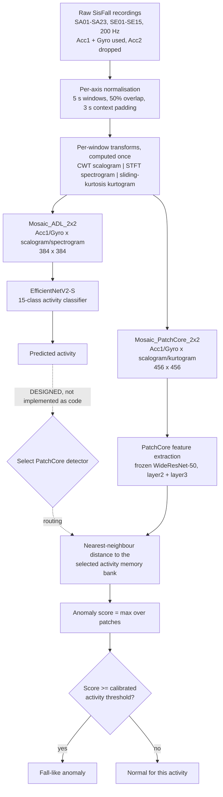
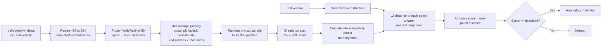

# SisFall-Model: Activity-Aware Fall Detection and Anomaly Scoring from Wearable Sensor Signals

A three-stage research pipeline built on the [SisFall](http://sistemic.udea.edu.co/en/research/projects/english-falls/) wearable-sensor dataset. Raw accelerometer and gyroscope recordings are converted into time-frequency RGB mosaic images; an **EfficientNetV2-S** classifier recognises the daily activity being performed; and **activity-specific PatchCore** detectors score a window against a memory bank of normal patterns for that activity, so that fall-like deviations can be detected relative to the activity rather than against one global notion of "normal".

> **Read this first: what is and is not implemented.**
> Stages 1, 2 and 3 are implemented and were executed (outputs are recorded in the notebooks). The **classifier-to-PatchCore routing and the unified fall/no-fall inference application are a designed workflow, not runnable code in this repository.** The only description of that routing is a commented "integration example" at the end of the PatchCore trainer cell. In addition, both trained models were evaluated with **window-wise splits** (all 38 subjects appear in training and evaluation partitions), so the reported numbers must **not** be read as evidence of generalisation to unseen people. See [Section 11](#11-data-splitting-validation-and-integrity-caveats).

---

## Table of Contents

1. [Project Overview](#1-project-overview)
2. [Project Status](#2-project-status)
3. [The SisFall Dataset](#3-the-sisfall-dataset)
4. [Repository and Folder Structure](#4-repository-and-folder-structure)
5. [End-to-End System Architecture](#5-end-to-end-system-architecture)
6. [Stage 1: Sensor-to-Image Generation](#6-stage-1-sensor-to-image-generation)
7. [Stage 2: EfficientNetV2-S Activity Classification](#7-stage-2-efficientnetv2-s-activity-classification)
8. [Stage 3: Activity-Specific PatchCore Anomaly Detection](#8-stage-3-activity-specific-patchcore-anomaly-detection)
9. [Technical Methodology and Rationale](#9-technical-methodology-and-rationale)
10. [Experimental Results and Analysis](#10-experimental-results-and-analysis)
11. [Data Splitting, Validation, and Integrity Caveats](#11-data-splitting-validation-and-integrity-caveats)
12. [Installation and Environment Setup](#12-installation-and-environment-setup)
13. [How to Run the Project](#13-how-to-run-the-project)
14. [Model Outputs and Saved Artifacts](#14-model-outputs-and-saved-artifacts)
15. [Research Contributions and Key Features](#15-research-contributions-and-key-features)
16. [Limitations and Future Work](#16-limitations-and-future-work)
17. [References](#17-references)
18. [Acknowledgements, License, and Citation](#18-acknowledgements-license-and-citation)
19. [Appendix A: Verification Notes and Discrepancies](#appendix-a-verification-notes-and-discrepancies)

---

## 1. Project Overview

Fall detection from wearable inertial sensors is usually framed as a single binary classification problem. This project instead decomposes it:

1. **Where am I in activity space?** Identify which daily activity a 5-second sensor window belongs to.
2. **Is this window abnormal for that activity?** Compare the window to a memory bank of normal windows of the same activity group, and flag it when its anomaly score exceeds an activity-specific, calibrated threshold.

The motivation is that the same signal energy can be normal in one context (e.g. jogging) and abnormal in another (e.g. sitting down). Separating the two questions lets each anomaly detector model a narrower, more homogeneous notion of "normal".

### The three stages

| Stage | Folder | Responsibility | Key technology |
|---|---|---|---|
| 1. Sensor-to-image generation | `Dataset to image generation model/` | Converts raw SisFall `.txt` recordings into two purpose-built RGB mosaic datasets | CWT (Morlet), STFT, sliding-window kurtosis, global colour normalisation |
| 2. Activity classification | `EfficientNetV2-S Model/` | Predicts one of 15 merged daily-activity classes from the ADL mosaic | EfficientNetV2-S, progressive fine-tuning, focal loss, EMA/SWA, 3-crop TTA, Grad-CAM |
| 3. Anomaly detection | `PatchCore model/` | Builds four activity-specific one-class detectors from the PatchCore mosaic | Frozen WideResNet-50, patch embeddings, greedy coreset memory bank, max nearest-neighbour distance, calibrated threshold |

### Headline results (see [Section 10](#10-experimental-results-and-analysis) for full tables and caveats)

- **EfficientNetV2-S** (15 classes, 2,477 test windows, 3-crop TTA): accuracy **96.65 %**, macro-F1 **0.9562**, weighted-F1 **0.9666**, Top-2 **99.64 %**, Top-3 **99.92 %**.
- **PatchCore**: fall recall is at least 99.86 % for all four detectors on the held-out half, but **specificity is strongly activity-dependent**: about 90 to 92 % for Walking and Jogging, versus **3.56 % for Sitting and 14.04 % for Standing_GettingUp**. High recall alone does not make a detector usable.

---

## 2. Project Status

| Component | Status | Evidence in repository |
|---|---|---|
| Stage 1: dual-mosaic generation script | Implemented | `SisFall_RGB_Mosaic_images_Pipeline.py` |
| Stage 2: EfficientNetV2-S training and evaluation | Implemented, executed, results recorded | Notebook cell outputs |
| Stage 3: four PatchCore detectors, calibration, evaluation, heatmaps | Implemented, executed, results recorded | Notebook cell outputs |
| Classifier-to-PatchCore routing | **Designed only.** A commented example exists; no executable code | End of PatchCore trainer cell |
| Unified inference script / application | **Not present** | n/a |
| Real-time wearable integration | **Not present** | n/a |
| Subject-independent validation (e.g. LOSO) | **Not performed** | Both splits are window-wise |
| Anomaly detectors for the other classifier classes | **Not present** | Only 4 detector groups exist |
| Trained weights, memory banks, generated images, raw data | **Not included in this repository** | Archive contains only three code files and a README |
| `requirements.txt` | **Not present** | See [Section 12](#12-installation-and-environment-setup) |

---

## 3. The SisFall Dataset

**SisFall** is a public dataset of simulated falls and activities of daily living (ADLs) recorded with a waist-worn embedded sensor board, released by the SISTEMIC research group (Universidad de Antioquia, Colombia) to support fall-detection research, including with elderly participants.

- Official page: <http://sistemic.udea.edu.co/en/research/projects/english-falls/>
- Dataset paper: Sucerquia, A.; López, J.D.; Vargas-Bonilla, J.F. *SisFall: A Fall and Movement Dataset.* Sensors 2017, 17(1), 198. <https://doi.org/10.3390/s17010198>

### 3.1 Subject groups

| Group | Subject IDs | Count | Description |
|---|---|---|---|
| Young adults | `SA01` to `SA23` | 23 | Young adult participants |
| Elderly | `SE01` to `SE15` | 15 | Elderly participants |
| **Total** | | **38** | |

The dataset paper reports approximate age ranges of 19 to 30 years (SA) and 60 to 75 years (SE); consult the official documentation for exact demographics. The subject-folder pattern enforced by the pipeline script is `^(SA|SE)\d{2}$`.

### 3.2 Recording format and sensors

Each trial is a plain-text file (one row per sample, nine data columns) sampled at **200 Hz**. SisFall documents three sensors on the same board:

| Sensor | Type | Columns in file | Name used in this project's code | Used by this pipeline? |
|---|---|---|---|---|
| ADXL345 | Accelerometer | 0 to 2 (X, Y, Z) | `Acc1` | **Yes** |
| ITG3200 | Gyroscope | 3 to 5 (X, Y, Z) | `Gyro` | **Yes** |
| MMA8451Q | Accelerometer | 6 to 8 (X, Y, Z) | `Acc2` | **No** (deliberately dropped) |

The script maps `Acc1`, `Gyro` and `Acc2` to column triplets 0-2, 3-5 and 6-8. The mapping of these labels to the chip names above follows the SisFall documentation and is not stated in the script itself. `Acc2` is excluded because it is a second accelerometer at the same mounting location and is judged redundant with `Acc1`, whereas the gyroscope adds a complementary modality (angular velocity).

### 3.3 Activity labels

**Daily Living Activities (D01 to D19)**

| Code | Activity | Code | Activity |
|---|---|---|---|
| D01 | Walking slowly | D11 | Sitting, trying to get up, collapse into chair |
| D02 | Walking quickly | D12 | Sitting, lying down slowly, sit again |
| D03 | Jogging slowly | D13 | Sitting, lying down quickly, sit again |
| D04 | Jogging quickly | D14 | Back and lateral position change |
| D05 | Stairs, slowly | D15 | Standing, bending at knees, getting up |
| D06 | Stairs, quickly | D16 | Standing, bending without knees, getting up |
| D07 | Sit, half-height chair, slowly | D17 | Get into a car, sit, get out |
| D08 | Sit, half-height chair, quickly | D18 | Stumble while walking |
| D09 | Sit, low-height chair, slowly | D19 | Gentle jump to reach an object |
| D10 | Sit, low-height chair, quickly | | |

**Simulated Falls (F01 to F15)** and the PatchCore activity group each is routed to by this project:

| Code | Fall type (SisFall) | Routed to PatchCore group |
|---|---|---|
| F01 | Forward fall while walking, caused by a slip | Walking |
| F02 | Backward fall while walking, caused by a slip | Walking |
| F03 | Lateral fall while walking, caused by a slip | Walking |
| F04 | Forward fall while walking, caused by a trip | Walking |
| F05 | Forward fall while jogging, caused by a trip | Jogging |
| F06 | Vertical fall while walking, caused by fainting | Walking |
| F07 | Fall while walking with hands on a table, caused by fainting | Walking |
| F08 | Forward fall when trying to get up | Standing_GettingUp |
| F09 | Lateral fall when trying to get up | Standing_GettingUp |
| F10 | Forward fall when trying to sit down | Sitting |
| F11 | Backward fall when trying to sit down | Sitting |
| F12 | Lateral fall when trying to sit down | Sitting |
| F13 | Forward fall while sitting, caused by fainting or falling asleep | Sitting |
| F14 | Backward fall while sitting, caused by fainting or falling asleep | Sitting |
| F15 | Lateral fall while sitting, caused by fainting or falling asleep | Sitting |

### 3.4 Trial structure observed in the generated data

The notebook logs are consistent with the SisFall trial structure: long single recordings for walking/jogging (windows up to `T90.0-95.0s` appear for D01), short repeated trials for most other ADLs, and 15-second fall trials (windows up to `T10.0-15.0s`; about 4.9 windows per fall trial with 5-second windows and 50 % overlap).

### 3.5 Dataset limitations relevant to this project

- **Simulated falls.** All falls are performed under laboratory conditions by volunteers; they are not real-world falls.
- **Elderly participation in fall trials.** According to the SisFall documentation, elderly participants performed ADLs but not simulated falls, with the exception of one elderly participant (`SE06`). This is consistent with the PatchCore notebook logs, where `SE06` is the only `SE` subject seen in sampled fall-window filenames, and with the fall-trial counts (e.g. 719 Walking-group fall trials). Fall data are therefore dominated by young-adult behaviour.

---

## 4. Repository and Folder Structure

### 4.1 Current repository (verified from the supplied archive)

```text
SisFall-Model/
├── README.md                                                  # This document (replaces the earlier README in the archive)
│
├── Dataset to image generation model/
│   └── SisFall_RGB_Mosaic_images_Pipeline.py                  # Stage 1: raw SisFall -> Mosaic_ADL_2x2 + Mosaic_PatchCore_2x2
│
├── EfficientNetV2-S Model/
│   └── sisfall-efficientnetv2-s-train2-advanced2.ipynb        # Stage 2: 15-class activity classifier (training + evaluation + Grad-CAM)
│
└── PatchCore model/
    └── sisfall-patchcore-train5.ipynb                         # Stage 3: organiser, window refiner, trainer, heatmaps, manual verification
```

The archive contains **no** raw data, generated images, model checkpoints, memory banks, logs, configuration files, or `requirements.txt`.

### 4.2 Directories created at run time (not stored in the repository)

These are produced by running the code. Paths in the notebooks are Kaggle paths (`/kaggle/input`, `/kaggle/working`).

```text
<project_root>/                                   # Passed to the Stage 1 script (or its hard-coded default)
├── SisFall_dataset/                              # INPUT: raw SisFall data, you must supply this
│   ├── SA01/ ... SA23/                           #   young adults; *.txt trials (e.g. D01_SA01_R01.txt, F05_SA01_R02.txt)
│   └── SE01/ ... SE15/                           #   elderly
│
└── Generated_Images_Mosaic/                      # OUTPUT of Stage 1
    ├── Mosaic_ADL_2x2/                           #   384x384 mosaics -> consumed by Stage 2
    │   ├── Daily Living/{activity}/{subject}/{stem}.png     # e.g. Walking_Slow/SA01/D01_SA01_R01_T0.0-5.0s.png
    │   └── Fall/{subject}/{stem}.png                         # e.g. SA01/F05_SA01_R02_T5.0-10.0s.png
    └── Mosaic_PatchCore_2x2/                     #   456x456 mosaics -> consumed by Stage 3
        ├── Daily Living/{activity}/{subject}/{stem}.png
        └── Fall/{subject}/{stem}.png
```

`{activity}` is the folder name from `ACTIVITY_LABELS` (e.g. `Walking_Slow`, `Sit_HalfHeight_Fast`, `Collapse_Into_Chair`). Window filenames follow `{trial}_T{t0:.1f}-{t1:.1f}s.png`.

**Stage 2 outputs** (written to `OUTPUT_DIR`, `/kaggle/working` in the notebook): checkpoints, split CSVs, plots and reports (see [Section 14](#14-model-outputs-and-saved-artifacts)).

**Stage 3 working and output directories** (all under `/kaggle/working` in the notebook):

```text
PatchCore_Ready/                                  # created by the organiser cell, modified by the refiner cell
├── organization_summary.csv
├── anomaly_refinement_summary.csv
└── {Walking | Jogging | Sitting | Standing_GettingUp}/
    ├── train/good/{sub_activity}/*.png           # normal windows for the memory bank, one subfolder per source sub-activity
    └── test/
        ├── good/*.png                            # held-out normal ADL windows
        ├── anomaly/*.png                         # refined fall windows (top-2 kurtogram-intensity per trial)
        ├── prefall_context/*.png                 # early windows from fall trials, treated as normal
        └── anomaly_excluded_ambiguous_postfall/  # moved aside, not deleted

patchcore_models/                                 # trainer output
├── memory_bank_{Activity}.pt
├── patchcore_{Activity}_analysis.png
└── patchcore_summary.csv

heatmap_visualizations/                           # heatmap cell output
├── heatmap_{Activity}.png
└── individual_test_15/{Activity}/{category}/*_result.png  (+ individual_test_summary.csv)

manual_verification/                              # manual verification cell output
└── {Activity}_{trial}.png
```

### 4.3 Recommended future organisation (not implemented)

This is a suggestion only; none of these files exist today.

```text
SisFall-Model/
├── requirements.txt              # pinned dependencies
├── configs/                      # extracted constants (paths, window length, thresholds)
├── src/                          # notebooks refactored into importable modules
├── inference/                    # classifier -> PatchCore routing + threshold decision
├── artifacts/                    # checkpoints, memory banks, calibrated thresholds (or Git LFS / release assets)
└── docs/                         # figures (example mosaics, confusion matrices, heatmaps)
```

---

## 5. End-to-End System Architecture



**How the stages relate**

1. **Stage 1** is a shared front end. Both mosaics come from the *same* per-window CWT/STFT/kurtosis computation; they differ only in which representations are placed in the columns and in the final cell size.
2. **Stage 2** consumes `Mosaic_ADL_2x2` (scalogram + spectrogram), the representation chosen for activity identification.
3. **Stage 3** consumes `Mosaic_PatchCore_2x2` (scalogram + kurtogram). The kurtogram is included specifically to expose impulsive events.
4. **Intended routing.** The classifier's predicted activity selects which PatchCore memory bank and threshold are used. The mapping sketched in the PatchCore trainer's comments is:

| Classifier output class | PatchCore detector |
|---|---|
| `Walking_Slow`, `Walking_Fast` | Walking |
| `Jogging` | Jogging |
| `Sitting` | Sitting |
| `Collapse_Into_Chair` | Standing_GettingUp |
| Other 10 classes (`Stairs_Slow`, `Stairs_Fast`, `Lying_Slow_SitAgain`, `Lying_Fast_SitAgain`, `Back_Lateral_Change`, `Standing_KneeBend`, `Standing_NoKneeBend`, `Car_InOut`, `Stumble_Walking`, `Gentle_Jump`) | **No detector; fallback policy undefined** |

> **Implementation status:** this routing exists only as a design and a code comment. The comment also refers to a classifier script (`train_final_v4.py`) that is not in this repository. The two models were trained and evaluated independently.

---

## 6. Stage 1: Sensor-to-Image Generation

**File:** `Dataset to image generation model/SisFall_RGB_Mosaic_images_Pipeline.py`

### 6.1 Processing pipeline

| Step | Implementation (verified in code) |
|---|---|
| Input parsing | `read_df` tries three delimiter configurations and drops all-empty columns; files with fewer than 9 columns are skipped |
| Channels | `Acc1` (cols 0-2), `Gyro` (cols 3-5). `Acc2` (cols 6-8) is defined but **not processed** (`MOSAIC_ROW_DEVICES = ['Acc1', 'Gyro']`) |
| Sampling rate | `FS = 200.0` Hz |
| Normalisation | Each axis of the **full recording** is zero-meaned and peak-normalised to [-1, +1] **once** (not per window) |
| Windowing | `SPLIT_WINDOW_S = 5.0` s, `SPLIT_OVERLAP = 0.5` (hop 2.5 s); **only full-length windows** are emitted |
| Context handling | `CONTEXT_S = 3.0`: each window is transformed with 3 s of extra signal on each side (taken from the same full recording) and then cropped to the window, which removes CWT/STFT edge artefacts |
| Transforms | CWT, STFT, and kurtosis map, computed once per device per window and reused by both mosaics |
| Rendering | Each map is drawn with matplotlib (8 x 4.5 in at 150 dpi, no axes), captured in memory, resized (LANCZOS) to 224 x 224, then converted to **grayscale** (ITU-R BT.601 luma) |
| Channel packing | The three axes (X, Y, Z) of a device are stacked as the **R, G, B** channels of one 224 x 224 cell |
| Mosaic assembly | Cells are resized to the variant's size and pasted into a 2 x 2 grid with 8 px black gutters |
| Output | Only the two mosaic variants are saved (`SAVE_INDIVIDUAL_REPRESENTATIONS = False`) |

> **Note on "RGB".** Each cell is not a colour-mapped picture. The colour map is applied only to render each single-axis map, which is then reduced to grayscale; the final R, G and B channels carry the X, Y and Z axis maps. Colour maps therefore matter through their **luminance ordering**, which is why monotonic-luminance maps were chosen.

### 6.2 Time-frequency representations

| Representation | Method | Parameters | Colour map | What it conveys |
|---|---|---|---|---|
| **Scalogram** | Continuous Wavelet Transform magnitude (`pywt.cwt`) | Morlet (`morl`), scales 1 to 128, `sampling_period = 1/FS` | `viridis` | Multi-scale time-frequency energy; wavelet scales adapt time resolution to frequency, so periodic gait cycles and short impacts are both visible. For a Morlet wavelet, frequency is approximately `f ≈ 0.8125 · fs / scale`, so small scales correspond to high frequencies |
| **Spectrogram** | Short-Time Fourier Transform power in dB (`scipy.signal.spectrogram`) | Hann window, `nperseg=256`, `noverlap=128`, `nfft=256`, `scaling='spectrum'`, 10·log10(S + 1e-12); y-axis 0 to FS/2 = 100 Hz | `inferno` | Frequency content over time at a fixed resolution (256 samples = 1.28 s); shows cadence bands for rhythmic activities |
| **Kurtogram** | Sliding-window **excess kurtosis** of the CWT magnitude along time, per scale row | Window 128 samples (0.64 s), step 64 samples (0.32 s); computed only on `scales[8:]` (`KURT_MIN_SCALE_IDX = 8`) | `cividis` | Highlights **impulsive** behaviour: values near 0 for steady/Gaussian-like segments, strongly positive for sudden impacts, negative for very regular segments |

> **Terminology caveat.** The "kurtogram" here is a custom CWT-based sliding-kurtosis map. It is **not** the fast kurtogram of Antoni (2007), which searches spectral kurtosis over frequency/bandwidth decompositions. That paper is cited only as background for the kurtosis idea.

**Why the lowest eight scales are excluded from the kurtogram (FIX A in the code).** Scales 1 to 8 (highest frequencies) are noise-dominated and previously rendered as a flat bright band that consumed luminance range. Excluding them returns that range to the mid/low scales where impulsiveness related to falls appears. The scalogram and spectrogram are unaffected and use their full ranges.

**Scale invariance of kurtosis.** Kurtosis is invariant to positive rescaling, so the kurtogram is unaffected by the per-recording peak normalisation.

### 6.3 Global colour bounds

Image intensities are mapped using **global** `(vmin, vmax)` bounds so that brightness is comparable across all images. The bounds are computed from **ADL files only** (never fall files), and only for the devices that appear in mosaics (`Acc1`, `Gyro`). A genuine fall therefore saturates against a scale calibrated on normal activity. Per-image min/max scaling would hide the fact that an image is unusually energetic.

With `USE_HARDCODED_BOUNDS = True` (the default in the supplied script) the following values are used and the scan is skipped:

| Representation | vmin | vmax |
|---|---|---|
| Scalogram | 3.7879e-05 | 3.6433 |
| Spectrogram (dB) | -110.91 | -16.12 |
| Kurtogram | -7.1396 | +7.1396 |

If CWT scales, STFT settings, the kurtogram scale range or the device set change, re-run with `--bounds-only` and update `HARDCODED_BOUNDS`.

### 6.4 The two mosaic variants

The two variants are **not** identical in configuration. Verified settings:

| Property | `Mosaic_ADL_2x2` | `Mosaic_PatchCore_2x2` |
|---|---|---|
| Rows | Acc1, Gyro | Acc1, Gyro |
| Columns | scalogram, spectrogram | scalogram, kurtogram |
| Cell size | **188 x 188** px | **224 x 224** px |
| Canvas | **384 x 384** px (2·188 + 8) | **456 x 456** px (2·224 + 8) |
| Gutter | 8 px black | 8 px black |
| Purpose | Activity identification | Anomaly / fall detection |
| Consumer | EfficientNetV2-S (Stage 2) | PatchCore (Stage 3) |

The ADL canvas is square, so resizing to a square network input does not distort the aspect ratio. Each representation is rendered and cached **once** at a shared 224 x 224 base size; each variant then performs only a cheap final resize, so transforms and matplotlib rendering are never repeated per variant.

**Directory layout.** Daily-living windows are saved under `Daily Living/{activity}/{subject}/`, fall windows under `Fall/{subject}/` (fall files are identified by a filename starting with `F`, ADLs by `D`). See [Section 4.2](#42-directories-created-at-run-time-not-stored-in-the-repository).

### 6.5 Computational notes

- Per window, only `Acc1` and `Gyro` are processed: 2 devices x 3 axes x 3 representations = 18 matplotlib renders. Excluding `Acc2` avoids nine unnecessary renders per window.
- The kurtogram reuses the CWT magnitudes already computed for the scalogram.
- The script is CPU-bound (matplotlib, PyWavelets, SciPy) and is expected to be slow on the full dataset.

---

## 7. Stage 2: EfficientNetV2-S Activity Classification

**File:** `EfficientNetV2-S Model/sisfall-efficientnetv2-s-train2-advanced2.ipynb` (two code cells: a data-folder discovery cell and one self-contained training/evaluation script)

### 7.1 Task, data and labels

- **Input:** `Mosaic_ADL_2x2` images (384 x 384), `IMG_SIZE = 384`, ImageNet mean/std normalisation.
- **Dataset used in the recorded run:** 16,437 images from 38 subjects, 15 classes (the run located a single dataset root).
- **Classes:** the 19 original D-codes were merged into **15** classes: `D03+D04 -> Jogging` and `D07+D08+D09+D10 -> Sitting`; all other codes remain individual classes. The merges were motivated by slow/fast pairs that the model was observed to confuse with each other.

| Class | Source codes | Images | Train | Val | Test |
|---|---|---|---|---|---|
| Walking_Slow | D01 | 1,476 | 1,033 | 221 | 222 |
| Walking_Fast | D02 | 1,508 | 1,055 | 226 | 227 |
| Jogging | D03 + D04 | 2,942 | 2,059 | 441 | 442 |
| Stairs_Slow | D05 | 1,685 | 1,179 | 252 | 254 |
| Stairs_Fast | D06 | 1,041 | 728 | 156 | 157 |
| Sitting | D07 to D10 | 2,250 | 1,575 | 337 | 338 |
| Collapse_Into_Chair | D11 | 569 | 398 | 85 | 86 |
| Lying_Slow_SitAgain | D12 | 570 | 399 | 85 | 86 |
| Lying_Fast_SitAgain | D13 | 360 | 251 | 54 | 55 |
| Back_Lateral_Change | D14 | 570 | 399 | 85 | 86 |
| Standing_KneeBend | D15 | 570 | 399 | 85 | 86 |
| Standing_NoKneeBend | D16 | 569 | 398 | 85 | 86 |
| Car_InOut | D17 | 1,607 | 1,124 | 241 | 242 |
| Stumble_Walking | D18 | 360 | 251 | 54 | 55 |
| Gentle_Jump | D19 | 360 | 251 | 54 | 55 |
| **Total** | | **16,437** | **11,499** | **2,461** | **2,477** |

Window counts per subject (15.0 for D11 to D16, D18, D19) are consistent with 5-second windows at 50 % overlap on 12-second trials with five repetitions.

### 7.2 Split methodology

`window_wise_split` shuffles **each class independently at the individual-image level** (seed 42) and assigns 70 % / 15 % / 15 % to train / validation / test. **All 38 subjects contribute to all three partitions.** This is **not** a subject-independent split (see [Section 11](#11-data-splitting-validation-and-integrity-caveats)). The split is saved as `split_train.csv`, `split_val.csv`, `split_test.csv`.

### 7.3 Model and training recipe

| Item | Setting (verified in code) |
|---|---|
| Architecture | `torchvision.models.efficientnet_v2_s`, pretrained weights `EfficientNet_V2_S_Weights.IMAGENET1K_V1` |
| Classifier head | `model.classifier[1]` replaced by `nn.Linear(in_features, 15)`; the torchvision dropout layer before it is retained |
| Weight loading | Retry loop (3 attempts) that clears corrupted cache files; **falls back to random initialisation** if every attempt fails (a warning is printed) |
| Loss | Custom **focal loss** (`gamma = 2.0`) wrapping cross-entropy with **label smoothing 0.15** and softened per-class weights |
| Class weights | `(1/count)^0.5`, normalised to sum to the number of classes (`ALPHA = 0.5`) |
| Sampling | `WeightedRandomSampler` with inverse-class-frequency weights, `replacement=True` |
| Optimiser | AdamW, `weight_decay = 2e-4` |
| Batch size | 32; seed 42 |
| Augmentation (train) | `RandomResizedCrop(384, scale=(0.90, 1.0), ratio=(1.0, 1.0))`, `RandomErasing(p=0.2, scale=(0.02, 0.06))`. **No flips, rotations, affine warps, or colour/hue jitter** |
| EMA | Decay 0.999 (`get_ema_avg_fn`, with a manual fallback), updated after every optimiser step in stages B and C |
| SWA | `AveragedModel` + `SWALR`, SGD (lr 1e-5, momentum 0.9), 8 epochs, followed by `update_bn` |
| Early stopping | Patience 8 epochs per stage (no early stop occurred in the recorded log; the best raw checkpoint was reached at global epoch 55, the last epoch of stage C) |

**Progressive fine-tuning schedule**

| Stage | Trainable parts | Learning rate(s) | Epochs | Scheduler |
|---|---|---|---|---|
| A: head only | Classifier | 1e-3 | 10 | None |
| B: fine-tune last 3 | Last 3 child modules of `model.features` + classifier | features 1e-5, classifier 1e-4 | 30 | Cosine annealing (T_max 30) |
| C: fine-tune last 6 | Last 6 child modules of `model.features` + classifier | features 3e-6, classifier 3e-5 | 15 | Cosine annealing (T_max 15) |
| D: SWA | All parameters | SGD 1e-5 | 8 | SWALR |

**Checkpoint selection.** Raw, EMA and SWA checkpoints are all saved. The one with the highest **validation** accuracy is used for final testing. In the recorded run, raw = 96.67 %, EMA = 96.63 %, SWA = 96.67 %; the raw checkpoint was selected (the tie with SWA resolves to the first candidate).

### 7.4 Evaluation protocol

- **3-crop test-time augmentation (TTA):** the full image, a 95 % centre crop and a 90 % centre crop, each resized to 384 x 384; softmax probabilities are averaged before `argmax`.
- Metrics: classification report, confusion matrix (raw and row-normalised), per-class TP/TN/FP/FN, precision, recall, specificity, F1, Top-2 and Top-3 accuracy.
- A "weak group" (sitting, collapse, lying, back/lateral, standing, car) receives a dedicated sub-confusion matrix and bar chart.
- **Grad-CAM:** implemented from scratch with forward/backward hooks on `features[-1][0]` (the final 1x1 convolution of the feature extractor). It is run on up to four random weak-group test samples, using the *true* class as the target, and overlays the map on the mosaic to check whether attention falls on signal content rather than gutters or borders.

---

## 8. Stage 3: Activity-Specific PatchCore Anomaly Detection

**File:** `PatchCore model/sisfall-patchcore-train5.ipynb` (six code cells, to be run in order)

| Cell | Role |
|---|---|
| 0 | Discovers the dataset folders under `/kaggle/input` |
| 1 | **Dataset organiser:** builds `PatchCore_Ready/` per activity group |
| 2 | **Anomaly window refiner:** labels fall windows as anomaly / pre-fall context / excluded |
| 3 | **PatchCore trainer and evaluator** (memory banks, threshold calibration, metrics) |
| 4 | **Heatmap visualisation** (overview grids and a 15-image individual test suite) |
| 5 | **Manual verification tool** for the window-selection heuristic |

### 8.1 Why PatchCore, and why activity-specific

- **One-class suitability.** Labelled falls are scarce, simulated and risky to collect from the people who most need protection. PatchCore needs **no gradient training, loss function or anomalous training examples**: its memory bank is built from normal (ADL) windows only.
- **Localisation.** Per-patch distances yield an anomaly heatmap, giving interpretability that a single scalar classifier lacks.
- **Activity-specific detectors.** Movement that is normal for one activity (high-energy jogging) would look abnormal in another (sitting). A single global bank must cover every normal pattern and so becomes permissive in some regions. Per-activity banks model a narrower normal distribution and let the threshold be tuned per activity.

### 8.2 The four detectors and their data

| Detector | Normal (ADL) source folders | Fall codes treated as anomalies |
|---|---|---|
| **Walking** | `Walking_Slow`, `Walking_Fast` (D01, D02) | F01, F02, F03, F04, F06, F07 |
| **Jogging** | `Jogging_Slow`, `Jogging_Fast` (D03, D04) | F05 |
| **Sitting** | `Sit_HalfHeight_Slow/Fast`, `Sit_LowHeight_Slow/Fast` (D07 to D10) | F10, F11, F12, F13, F14, F15 |
| **Standing_GettingUp** | `Collapse_Into_Chair` (D11 only) | F08, F09 |

Note that the Standing_GettingUp detector's *normal* data comes **only from D11** (collapse into chair), the closest available ADL to a get-up motion. `Standing_KneeBend`/`Standing_NoKneeBend` (D15, D16) are not part of it.

**Dataset sizes (recorded run)**

| Detector | train/good | test/good | Fall windows before refinement (trials) | Kept anomaly | Pre-fall context | Excluded |
|---|---|---|---|---|---|---|
| Walking | 2,387 | 597 | 3,529 (719) | 1,438 | 650 | 1,441 |
| Jogging | 2,354 | 588 | 596 (120) | 240 | 26 | 330 |
| Sitting | 1,800 | 450 | 3,555 (719) | 1,438 | 119 | 1,998 |
| Standing_GettingUp | 455 | 114 | 1,188 (240) | 480 | 50 | 658 |

The good-image split is **80 % train / 20 % test** (`TRAIN_GOOD_FRACTION = 0.80`), implemented window-wise: the log shows all 38 subjects in both `train/good` and `test/good`.

### 8.3 Fall-window refinement (heuristic)

A 15-second fall trial yields about five overlapping windows, but only one or two contain the impact. Treating all of them as anomalies would label calm pre-/post-fall windows as falls and corrupt threshold calibration. The refiner therefore, **per trial**:

1. Scores each window by the **standard deviation of pixel values in the kurtogram column** of the mosaic (x = 232 to 456, both rows), as a proxy for impulsiveness. A flat grey kurtogram scores low; a sharp, high-contrast impact scores high.
2. Keeps the **top-2** highest-scoring windows (`TOP_K_WINDOWS_PER_TRIAL = 2`) as `test/anomaly`.
3. Windows at least two positions *before* the earliest kept window (`PREFALL_BUFFER_WINDOWS = 1`) are moved to `test/prefall_context` and treated as confidently normal.
4. The remaining windows (adjacent to the impact, or after it) are moved to `test/anomaly_excluded_ambiguous_postfall` and not used.

This is an **unsupervised, image-intensity heuristic, not ground-truth annotation** (see [Section 11](#11-data-splitting-validation-and-integrity-caveats)). The manual verification cell lets the user visually inspect eight random trials per activity with the kept / pre-fall / excluded labels.

### 8.4 PatchCore workflow, step by step



1. **Preprocessing.** Each 456 x 456 mosaic is resized to 224 x 224 (`PATCHCORE_IMG_SIZE`) and normalised with ImageNet statistics. Resizing halves the spatial detail; the code notes that the size could be increased at higher memory/compute cost.
2. **Frozen backbone.** `wide_resnet50_2` with `IMAGENET1K_V1` weights; all parameters have `requires_grad = False`. Forward hooks capture `layer2` (512 channels, 28 x 28) and `layer3` (1024 channels, 14 x 14).
3. **Patch embeddings.** Each feature map is smoothed with a 3 x 3 average pool (stride 1, padding 1) to add local context; `layer3` is bilinearly upsampled to 28 x 28; the maps are concatenated to **1,536-dimensional** vectors, giving **784 patch embeddings per image**.
4. **Pre-subsampling.** Raw patches of each sub-activity (hundreds of thousands) are uniformly subsampled to at most `RAW_PATCH_SUBSAMPLE_CAP = 40,000`. The code comments record that full-size greedy selection was estimated at ~11 hours per activity on CPU.
5. **Greedy coreset (farthest-point / k-center sampling).** Starting from the first patch, the algorithm repeatedly adds the patch farthest from the already-selected set (maintaining a running minimum distance). The target size is `min(2% of patches, 2,000)`; because the pre-subsample is 40,000, the effective target is **800 points per sub-activity**. The result is a true subset of real patches.
6. **Sub-activity balancing.** One mini-bank is built **per original sub-activity** and the banks are concatenated, so each sub-activity receives its own 800 points regardless of how the pooled data is distributed. This was introduced to address low specificity; for single-source groups it changes nothing.

| Detector | Sub-activity banks | Final memory-bank size |
|---|---|---|
| Walking | 2 x 800 | 1,600 |
| Jogging | 2 x 800 | 1,600 |
| Sitting | 4 x 800 | 3,200 |
| Standing_GettingUp | 1 x 800 | 800 |

7. **Scoring.** For each test image, every patch's L2 distance to its **nearest** memory-bank entry is computed (`torch.cdist`); the **maximum** over patches is the image anomaly score.
8. **Heatmaps.** The per-patch nearest-neighbour distances form a 28 x 28 map, bilinearly upsampled to 224 x 224 and overlaid with the `jet` colour map. The hottest pixel is circled and labelled with its mosaic quadrant.

**Differences from the original PatchCore paper.** The implementation is a simplified variant: it does not implement the paper's feature-dimension reduction, random-projection acceleration of the coreset, or nearest-neighbour re-weighting of the image score. The pre-subsampling step is an added tractability measure.

### 8.5 Threshold calibration and evaluation split

For each detector, `test/good` and `test/anomaly` are **each shuffled and split 50/50** (`CALIBRATION_FRACTION = 0.5`):

- **Calibration half:** used only to choose the threshold. The threshold is the **minimum anomaly score among calibration fall windows**, so calibration recall is 100 % by construction.
- **Final held-out half:** used to report recall, specificity and FPR. The threshold is not tuned on it.

Reported metrics: recall (sensitivity), specificity, FPR, **trial-level recall** (a fall trial counts as detected if at least one of its held-out windows is flagged), specificity on `prefall_context` windows (reported separately), and ROC-AUC (computed on the **pooled calibration + held-out** scores). A normalised 0-1 score (min-max over the calibration range) exists for display only; decisions use the raw threshold.

The code docstring explains the trap this avoids: choosing the threshold as the lowest score among *all* test falls would guarantee 100 % recall on the same data, which is not a meaningful result. Note, however, that **fall windows are still used for threshold selection**, so the detector is one-class only with respect to *memory-bank construction*.

### 8.6 Heatmap interpretation by mosaic quadrant

After resizing, the quadrant boundary lies at pixel 114 of 224. The peak patch is assigned to one of four regions:

| | Left column (scalogram) | Right column (kurtogram) |
|---|---|---|
| **Top row** | `Acc1-Scalogram` | `Acc1-Kurtogram` |
| **Bottom row** | `Gyro-Scalogram` | `Gyro-Kurtogram` |

The notebook suggests that a correctly flagged fall whose peak lies on a kurtogram quadrant is consistent with the impact signature the kurtogram was designed to expose, whereas a peak in a scalogram quadrant means the flag was triggered by other content. In the recorded 5-image Walking fall spot-check, four of five peaks fell in scalogram quadrants and one in `Acc1-Kurtogram`; this is far too small a sample to draw conclusions.

The heatmap cell uses one **fixed colour scale** (the calibration score range) across all images, because auto-scaling each image to its own min/max makes even a calm window look "hot".

---

## 9. Technical Methodology and Rationale

Only techniques present in the code are listed.

### 9.1 Image generation

| Technique | What it does | Why it is used here |
|---|---|---|
| CWT (Morlet) | Multi-scale time-frequency magnitude | Resolves both rhythmic gait energy and short impacts |
| STFT / spectrogram | Fixed-resolution frequency content over time | Reveals cadence bands that distinguish activities |
| Sliding-window kurtosis | Local impulsiveness per CWT scale | Highlights sudden events against steady motion |
| Sliding-window segmentation | 5 s windows, 2.5 s hop, full windows only | Fixed-size inputs; overlap avoids splitting an event across a boundary |
| Context padding | 3 s of extra signal per side before transform | Removes CWT/STFT edge artefacts |
| Global (ADL-only) colour normalisation | Fixed vmin/vmax from normal data | Makes brightness comparable and lets falls stand out |
| RGB mosaic | X/Y/Z axes as R/G/B; 2 x 2 device-by-representation grid | Packs several views into one image for a standard 2D CNN |
| Transform reuse | Compute once, assemble both variants | Avoids duplicate CWT/STFT/render work |

### 9.2 EfficientNetV2-S

| Technique | What it does | Why it is used here |
|---|---|---|
| Transfer learning | Starts from ImageNet weights | Small dataset relative to model size |
| Progressive fine-tuning | Head, then last 3 blocks, then last 6, at falling LRs | Adapts high-level features first, limiting damage to pretrained features |
| AdamW | Adam with decoupled weight decay | Regularisation against the observed train/val gap |
| Label smoothing (0.15) | Softens one-hot targets | Reduces over-confidence between near-identical classes |
| Focal loss (gamma 2) | Down-weights easy examples | Concentrates learning on ambiguous classes (Sitting, Standing_KneeBend) |
| Softened class weights + weighted sampler | Compensates class imbalance | Class sizes range from 360 to 2,942 images; both mechanisms are applied together |
| Safe augmentation | Mild random crop and random erasing only | Flips/rotations/colour jitter would create physically impossible signals or distort the intensity encoding |
| EMA / SWA | Weight averaging | Smoother, more stable final weights; all three variants compared on validation |
| 3-crop TTA | Averages predictions over three crops | Small robustness gain at inference |
| Grad-CAM | Class-activation overlay | Checks the model attends to signal content rather than borders |

### 9.3 PatchCore

| Technique | What it does | Why it is used here |
|---|---|---|
| Frozen pretrained extractor | WideResNet-50, no training | No anomalous training data is needed |
| Multi-layer features | `layer2` + `layer3` concatenated | Combines finer and more semantic patch descriptions |
| Local average pooling | 3 x 3 neighbourhood smoothing | Adds local context to each patch |
| Greedy coreset | Farthest-point subset of patches | Keeps coverage of normal patterns at tractable memory and search cost |
| Per-sub-activity banks | Separate coreset per source activity | Guarantees balanced representation of normal sub-types |
| Nearest-neighbour distance | Patch-to-bank L2 distance | Measures how unlike any known normal patch each region is |
| Max-over-patches score | Worst patch defines the image score | Sensitive to localised anomalies |
| Calibrated threshold | Chosen on a separate calibration half | Avoids tuning the threshold on reported data |
| Anomaly heatmap | Upsampled patch-distance map | Localisation and interpretability |

---

## 10. Experimental Results and Analysis

All figures below are taken from the recorded notebook outputs. **They come from window-wise splits (Section 11) and should be treated as in-distribution results.**

### 10.1 EfficientNetV2-S (test set, 3-crop TTA, 2,477 windows)

| Metric | Value |
|---|---|
| Test accuracy | **96.65 %** |
| Macro-F1 | **0.9562** |
| Weighted-F1 | **0.9666** |
| Top-2 accuracy | **99.64 %** |
| Top-3 accuracy | **99.92 %** |
| Test samples | 2,477 |

**Per-class results**

| Class | Precision | Recall | F1 | Support |
|---|---|---|---|---|
| Walking_Slow | 0.9911 | 1.0000 | 0.9955 | 222 |
| Walking_Fast | 1.0000 | 0.9956 | 0.9978 | 227 |
| Jogging | 1.0000 | 0.9910 | 0.9955 | 442 |
| Stairs_Slow | 0.9881 | 0.9803 | 0.9842 | 254 |
| Stairs_Fast | 0.9745 | 0.9745 | 0.9745 | 157 |
| Sitting | 0.9675 | 0.8817 | 0.9226 | 338 |
| Collapse_Into_Chair | 0.8750 | 0.9767 | 0.9231 | 86 |
| Lying_Slow_SitAgain | 0.9529 | 0.9419 | 0.9474 | 86 |
| Lying_Fast_SitAgain | 0.9138 | 0.9636 | 0.9381 | 55 |
| Back_Lateral_Change | 0.9348 | 1.0000 | 0.9663 | 86 |
| Standing_KneeBend | 0.8387 | 0.9070 | 0.8715 | 86 |
| Standing_NoKneeBend | 0.8646 | 0.9651 | 0.9121 | 86 |
| Car_InOut | 0.9873 | 0.9669 | 0.9770 | 242 |
| Stumble_Walking | 0.9649 | 1.0000 | 0.9821 | 55 |
| Gentle_Jump | 0.9310 | 0.9818 | 0.9558 | 55 |

**Interpretation.** Locomotion classes (Walking, Jogging, Stairs) are classified almost perfectly. Weaker performance is concentrated in the sit/stand/lying group: `Standing_KneeBend` is the weakest class (F1 0.8715; precision 83.9 %, recall 90.7 %), `Sitting` has the lowest recall (88.2 %, 40 of 338 missed), and `Collapse_Into_Chair` and `Standing_NoKneeBend` have the lowest precision after `Standing_KneeBend` (87.5 % and 86.5 %). The gap between Top-1 (96.65 %) and Top-2 (99.64 %) indicates the remaining errors are mostly confusions between kinematically similar neighbours rather than unrelated mistakes. Perfect recall (100 %) was reached by `Walking_Slow`, `Back_Lateral_Change` and `Stumble_Walking`.

### 10.2 PatchCore (final held-out half)

| Detector | Recall | Specificity | FPR | Trial-level recall | ROC-AUC | Pre-fall-context specificity |
|---|---|---|---|---|---|---|
| Walking | 99.86 % | 91.97 % | 8.03 % | 99.81 % (538/539) | 0.9996 | 12.00 % |
| Jogging | 100.00 % | 90.14 % | 9.86 % | 100.00 % (89/89) | 0.9992 | 19.23 % |
| Sitting | 99.86 % | **3.56 %** | **96.44 %** | 100.00 % (547/547) | 0.8072 | 5.88 % |
| Standing_GettingUp | 100.00 % | **14.04 %** | **85.96 %** | 100.00 % (176/176) | 0.7568 | 22.00 % |

**Held-out sample sizes and operating points**

| Detector | Held-out normal / fall windows | Threshold (raw score) | Memory bank |
|---|---|---|---|
| Walking | 299 / 719 | 2.3569 | 1,600 |
| Jogging | 294 / 120 | 2.3101 | 1,600 |
| Sitting | 225 / 719 | 2.3123 | 3,200 |
| Standing_GettingUp | 57 / 240 | 2.4507 | 800 |

**Discussion**

- **Strong detectors: Walking and Jogging.** Both combine near-complete recall with roughly 90 to 92 % specificity and ROC-AUC above 0.999. The Jogging held-out normal count (294) and especially its fall count (120 windows) are modest.
- **Weak detectors: Sitting and Standing_GettingUp.** Recall is 99.86 % and 100 %, but the detectors flag 96.4 % and 86.0 % of normal windows. The ROC-AUC values (0.81 and 0.76) confirm that the score distributions overlap heavily, so no threshold could separate them well. The notebook documents two targeted attempts (window-label refinement, then per-sub-activity balanced banks) that did not resolve this. A plausible explanation, not tested here, is that normal sit-down and get-up motions resemble sit-related falls in this mosaic representation; the Standing_GettingUp detector is also trained on only 455 windows from a single source activity.
- **Why false positives matter.** A fall alarm that triggers on nearly every normal sitting window would cause alarm fatigue and make the system unusable in practice, regardless of its recall. **High recall is trivially obtainable by setting a low threshold; the meaningful quantity is recall at an acceptable false-alarm rate.** For the Sitting and Standing_GettingUp detectors, specificity of 3.56 % and 14.04 % means the near-perfect recall conveys almost no discriminative value.
- **Pre-fall-context specificity is low for all four detectors (5.9 % to 22.0 %).** Windows from the start of fall trials are labelled "normal" by the refiner, yet are flagged as anomalous. Possible causes include genuine pre-fall instability, differences between fall-trial and ADL-trial execution, or labelling noise from the heuristic; the code does not determine which.
- **Recall is not independent of the heuristic.** Because anomaly windows are selected by kurtogram intensity (Section 8.3) and the detector then scores images that include the kurtogram, the held-out recall is likely optimistic (see Section 11).

### 10.3 Comparative summary

| Model | Main purpose | Input | Output | Evaluation focus |
|---|---|---|---|---|
| Image generation | Signal-to-image conversion | Raw 200 Hz Acc1 + Gyro signals | Two RGB mosaic datasets | Representation quality (visual QA checklist in the script docstring; no quantitative metric) |
| EfficientNetV2-S | Activity classification | `Mosaic_ADL_2x2` (384 x 384) | One of 15 activity classes | Accuracy, macro/weighted-F1, Top-k, per-class metrics |
| PatchCore | Anomaly detection | `Mosaic_PatchCore_2x2` (456 x 456, resized to 224) | Anomaly score, fall-like / normal decision, heatmap | Recall, specificity, FPR, trial-level recall, ROC-AUC |

---

## 11. Data Splitting, Validation, and Integrity Caveats

### 11.1 What was implemented

| Model | Split | Granularity | Subjects in each partition |
|---|---|---|---|
| EfficientNetV2-S | 70 / 15 / 15 train / val / test, stratified per class (`window_wise_split`, seed 42) | Individual image (window) | **All 38 subjects in all three partitions** |
| PatchCore: good windows | 80 / 20 `train/good` vs `test/good` (`window_wise_good_split`, seed 42) | Individual image | **All 38 subjects in both** (shown in the notebook log) |
| PatchCore: threshold | Random 50 / 50 calibration vs final split of `test/good` and of `test/anomaly` (`calibration_split`, seed 42) | Individual image | Not subject-aware |

**This is not Leave-One-Subject-Out (LOSO) validation and not any subject-independent protocol.** The results do not demonstrate generalisation to unseen individuals.

### 11.2 Sources of potential leakage

1. **Subject-level leakage.** The same person's gait, posture and sensor-wearing signature appear in both training and evaluation data. A model can partly learn "this person" rather than "this activity", inflating accuracy for the classifier and specificity for PatchCore (whose memory bank may contain patches from the very subject being tested).
2. **Overlapping windows.** With a 5-second window and 2.5-second hop, adjacent windows share half their signal. Under a random image-level split, near-duplicate windows from the same trial can land in different partitions. This inference follows from the pipeline parameters and the split code.
3. **Calibration and held-out halves of falls.** Fall windows from the same trial, including the two adjacent top-2 windows, can fall into both the calibration and the "held-out" half.
4. **Label-selection circularity.** Anomaly windows are chosen by kurtogram-region intensity, and the detector scores images that contain the kurtogram. High recall is partly built into the labelling.

### 11.3 Why subject-wise validation is required

Wearable fall detection is intended to work for new users with different body mass, gait and sensor placement. Only validation that withholds *entire subjects* (preferably LOSO or grouped k-fold, with elderly subjects represented) can estimate this. Until then, the reported figures are best read as upper-bound, in-distribution results.

### 11.4 Documented intent versus implementation

Several comments in the code describe a **subject-wise** split (the classifier's docstring and the PatchCore organiser's docstring and a config comment), and one plot title and a print statement say "subject-wise", but the executed functions are window-wise and the logs confirm it. The window-wise behaviour is what was run. Full detail is in [Appendix A](#appendix-a-verification-notes-and-discrepancies).

### 11.5 Other verified limitations

- **Low specificity** for the Sitting (3.56 %) and Standing_GettingUp (14.04 %) detectors.
- **Simulated, young-adult-dominated falls** (Section 3.5).
- **Heuristic fall-window refinement**, with no manual ground-truth annotation of impact timing.
- **Limited PatchCore coverage:** four detectors for a 15-class classifier; ten classifier classes have no detector and no fallback.
- **No executable routing or end-to-end inference** (Section 5).
- **Single run, single seed** (42); no confidence intervals or repeated-split variance.
- **Small held-out sets for some detectors** (Standing_GettingUp: 57 normal windows; Jogging: 120 fall windows).
- **Aggressive resize** of the 456 x 456 PatchCore mosaic to 224 x 224 before feature extraction.

---

## 12. Installation and Environment Setup

> No `requirements.txt` or environment file exists in the repository. The following is derived from the imports in the three code files. **The Python and library versions used for the recorded results are not recorded.** Both notebooks were run on a Kaggle CUDA GPU (the logs print `Device: cuda`); the exact GPU model is not recorded.

### 12.1 Libraries actually imported

| Library | Used by | Purpose |
|---|---|---|
| `numpy`, `pandas`, `scipy`, `matplotlib`, `Pillow` | All stages | Numerics, tables, STFT, plotting, image I/O |
| `PyWavelets` (`pywt`) | Stage 1 | Continuous wavelet transform |
| `torch`, `torchvision` | Stages 2, 3 | Models, data loading, pretrained weights |
| `scikit-learn` | Stages 2, 3 | Metrics, ROC-AUC |
| `seaborn` | Stages 2, 3 | Confusion-matrix and plot styling |

Version-related notes from the code: `torchvision.models.EfficientNet_V2_S_Weights` requires torchvision 0.13 or newer; `torch.optim.swa_utils.get_ema_avg_fn` is used with a fallback for older PyTorch; Stage 1 calls `DataFrame.map` (pandas 2.1 or newer), wrapped in a `try/except`. Python is not pinned; a recent Python 3 release is assumed.

### 12.2 Hardware

- **Stage 1** is CPU-only and compute-heavy (hundreds of thousands of matplotlib renders for the full dataset). Multi-core CPU and fast storage help.
- **Stages 2 and 3** were run on a CUDA GPU. Stage 2 (384 x 384 images, 63 total epochs including SWA) and the PatchCore greedy coreset / `cdist` search are impractically slow on CPU. A GPU is strongly recommended.

### 12.3 Setup

```bash
# 1. Create a virtual environment
python -m venv venv

# 2. Activate it
source venv/bin/activate          # Linux / macOS
venv\Scripts\activate             # Windows (cmd or PowerShell)

# 3. Install dependencies (choose the PyTorch build for your CUDA version from https://pytorch.org/get-started/locally/)
pip install --upgrade pip
pip install numpy pandas scipy matplotlib seaborn pillow scikit-learn PyWavelets
pip install torch torchvision
pip install jupyter               # to run the notebooks locally
```

Creating a pinned `requirements.txt` (for example via `pip freeze` after a verified run) is recommended future work.

---

## 13. How to Run the Project

### Dependency order

```text
Stage 1 (must run first)  --> Mosaic_ADL_2x2        --> Stage 2 (EfficientNetV2-S)
                          --> Mosaic_PatchCore_2x2  --> Stage 3 (PatchCore)
```

Stages 2 and 3 read different mosaic outputs and are **independent of each other**; they can run in either order or in parallel after Stage 1.

### Step 1: Prepare the dataset

Download SisFall from the [official page](http://sistemic.udea.edu.co/en/research/projects/english-falls/) and arrange it as:

```text
<project_root>/
└── SisFall_dataset/
    ├── SA01/  D01_SA01_R01.txt, D01_SA01_R02.txt, ..., F15_SA01_R05.txt
    ├── ...
    ├── SA23/
    ├── SE01/
    ├── ...
    └── SE15/
```

Subject folders must match `SA##` or `SE##`. The raw directory name is `SisFall_dataset` (`RAW_DATA_DIR`).

### Step 2: Generate the mosaic images

```bash
cd "Dataset to image generation model"

# Full run: generates both mosaic datasets
python SisFall_RGB_Mosaic_images_Pipeline.py "/path/to/project_root"

# Optional: scan ADL files and print fresh colour bounds, write no images
python SisFall_RGB_Mosaic_images_Pipeline.py "/path/to/project_root" --bounds-only
```

- The only supported arguments are one optional positional directory and `--bounds-only`.
- **If no directory is given, the script uses `DEFAULT_BASE_DIR`, hard-coded to a Windows path (`D:\4.2\CSE 400-B\SisFall-Model`).** Always pass your own path or edit this constant.
- Output: `<project_root>/Generated_Images_Mosaic/{Mosaic_ADL_2x2, Mosaic_PatchCore_2x2}/...`. The script prints progress per subject and per file.
- By default the hard-coded colour bounds are used (`USE_HARDCODED_BOUNDS = True`).

### Step 3: Train and evaluate EfficientNetV2-S

1. Open `EfficientNetV2-S Model/sisfall-efficientnetv2-s-train2-advanced2.ipynb` (designed for Kaggle with the generated mosaics attached as an input dataset).
2. Make the paths point to your data. The notebook finds data with `glob("/kaggle/input/**/Mosaic_ADL_2x2/Daily Living")` and writes to `OUTPUT_DIR = "/kaggle/working"`; change both for local use.
3. Run cell 0 (folder discovery), then cell 1 (training and evaluation, a single script without CLI arguments).
4. It trains for up to 63 epochs (10 + 30 + 15 head/fine-tune, plus 8 SWA), selects the best checkpoint on validation accuracy, and evaluates on the test split with TTA. Outputs are listed in [Section 14](#14-model-outputs-and-saved-artifacts).

### Step 4: Train and evaluate PatchCore

1. Open `PatchCore model/sisfall-patchcore-train5.ipynb`.
2. Edit the Kaggle paths (`find_patchcore_root` glob, `OUTPUT_ROOT`, `OUTPUT_DIR` constants, `/kaggle/working/...` lookups) for local use.
3. **Run cells 0 to 5 in order.**
   - Cell 1 *copies* files into `PatchCore_Ready/`.
   - Cell 2 *moves* files inside `PatchCore_Ready/`. **It is not idempotent: run it exactly once.** To redo it, delete `PatchCore_Ready/` and re-run cell 1 first.
   - Cell 3 builds memory banks (the greedy coreset is the slowest step), calibrates thresholds, and writes the summary.
   - Cells 4 and 5 need cell 3's outputs (`memory_bank_*.pt`, `patchcore_summary.csv`) and, for cell 5, the original `Mosaic_PatchCore_2x2` folder.

No command-line scripts exist for Stages 2 and 3; both are notebooks.

---

## 14. Model Outputs and Saved Artifacts

### 14.1 Saved by the current implementation (as defined in code)

| Stage | Artifact | Description |
|---|---|---|
| 1 | `Generated_Images_Mosaic/Mosaic_ADL_2x2/...png` | 384 x 384 mosaics for the classifier |
| 1 | `Generated_Images_Mosaic/Mosaic_PatchCore_2x2/...png` | 456 x 456 mosaics for PatchCore |
| 2 | `final_efficientnetv2s_adl.pt`, `_ema.pt`, `_swa.pt` | Raw, EMA and SWA weights (`state_dict`s) |
| 2 | `split_train.csv`, `split_val.csv`, `split_test.csv` | Exact reproducible window-wise split |
| 2 | `classification_report_final.txt`, `per_class_metrics_final.csv` | Report and per-class TP/TN/FP/FN, precision, recall, specificity, F1 |
| 2 | `training_curves_final.png` | Loss, accuracy, error and macro-F1 curves |
| 2 | `confusion_matrix_final.png`, `confusion_matrix_normalized_final.png` | Raw and row-normalised confusion matrices |
| 2 | `weak_group_confusion_final.png`, `per_class_accuracy_bar_final.png` | Weak-group analysis |
| 2 | `gradcam_weak_group_final.png` | Grad-CAM overlays (skipped with a warning if the step errors) |
| 3 | `PatchCore_Ready/organization_summary.csv`, `anomaly_refinement_summary.csv` | Dataset organisation and refinement summaries |
| 3 | `patchcore_models/memory_bank_{Activity}.pt` | Memory bank tensor (the "trained model") per activity |
| 3 | `patchcore_models/patchcore_{Activity}_analysis.png` | Score histogram and ROC curve |
| 3 | `patchcore_models/patchcore_summary.csv` | Thresholds, calibration ranges, recall, specificity, FPR, pre-fall specificity, trial recall, ROC-AUC |
| 3 | `heatmap_visualizations/heatmap_{Activity}.png` | Overview anomaly-heatmap grids (8 normal + 8 fall samples) |
| 3 | `heatmap_visualizations/individual_test_15/...` | Per-image result figures (5 good, 5 pre-fall, 5 anomaly per activity) and `individual_test_summary.csv` |
| 3 | `manual_verification/{Activity}_{trial}.png` | Window-selection spot checks (8 trials per activity) |

### 14.2 Not saved or not present

- A saved **model-routing configuration**, a **combined threshold file** or any **unified inference artifact**: not produced.
- A **standalone saved scoring function** for PatchCore: the memory bank is saved, but the feature extractor and scoring code live only in the notebook.
- None of the artifacts above are included in this repository archive.

---

## 15. Research Contributions and Key Features

The contributions below describe the work implemented here. No claim of novelty, state-of-the-art performance, clinical validity or real-world deployment is made.

- **Signal-to-image conversion with multiple time-frequency views.** Wearable accelerometer and gyroscope signals are converted into scalograms, spectrograms and a CWT-based kurtosis map, normalised with global ADL-only colour bounds.
- **Two purpose-built RGB mosaic formats** generated from a single shared computation: a scalogram + spectrogram mosaic for activity recognition and a scalogram + kurtogram mosaic for anomaly detection.
- **Multi-class daily activity recognition** with EfficientNetV2-S using progressive fine-tuning, imbalance handling, restricted augmentation, EMA/SWA and TTA.
- **Activity-specific PatchCore detectors** whose memory banks are built exclusively from normal ADL windows, with sub-activity-balanced coresets.
- **Threshold calibration with a separate held-out evaluation half**, trial-level recall, and a separate pre-fall-context specificity measure.
- **Interpretability tools:** Grad-CAM for the classifier; quadrant-labelled, fixed-scale anomaly heatmaps for PatchCore; a manual verification tool for the window-selection heuristic.
- **Transparent reporting of weak results**, including near-zero specificity for two detectors.

---

## 16. Limitations and Future Work

### 16.1 Completed work

Stage 1 generation; Stage 2 training and evaluation; Stage 3 organisation, refinement, memory-bank construction, calibration, evaluation, heatmaps and manual verification.

### 16.2 Known limitations

See [Section 11.5](#115-other-verified-limitations) for the verified list and [Section 10.2](#102-patchcore-final-held-out-half) for detector-level weaknesses.

### 16.3 Proposed future work (not yet done)

| Priority | Direction |
|---|---|
| High | **Subject-wise validation**, including Leave-One-Subject-Out or grouped k-fold, with trial-aware grouping so overlapping windows never straddle partitions |
| High | Re-evaluate PatchCore with subject-disjoint `train/good` and `test/good`, and trial-disjoint calibration and test splits |
| High | **Improve Sitting and Standing_GettingUp specificity** and reduce false-positive rates generally |
| High | **Implement classifier-to-PatchCore routing** and a unified inference pipeline, including a defined fallback for activities without a detector |
| Medium | Replace the kurtogram-intensity heuristic with better fall-window annotation (for example impact-time labels from signal peaks or manual review) |
| Medium | Extend anomaly detectors to all 15 classifier classes (or justified groupings) |
| Medium | Evaluate higher PatchCore input resolution; ablate score aggregation and coreset size |
| Medium | Repeat runs over several seeds and report variance |
| Longer term | External-dataset validation; real-time wearable sensor integration; model optimisation and deployment; a pinned environment and packaged inference module |

---

## 17. References

1. **SisFall dataset (official page).** SISTEMIC, Universidad de Antioquia. <http://sistemic.udea.edu.co/en/research/projects/english-falls/>
2. Sucerquia, A.; López, J.D.; Vargas-Bonilla, J.F. *SisFall: A Fall and Movement Dataset.* Sensors **2017**, 17(1), 198. <https://doi.org/10.3390/s17010198>
3. Tan, M.; Le, Q.V. *EfficientNetV2: Smaller Models and Faster Training.* ICML 2021. <https://arxiv.org/abs/2104.00298>
4. Roth, K.; Pemula, L.; Zepeda, J.; Schölkopf, B.; Brox, T.; Gehler, P. *Towards Total Recall in Industrial Anomaly Detection (PatchCore).* CVPR 2022. <https://arxiv.org/abs/2106.08265>
5. Zagoruyko, S.; Komodakis, N. *Wide Residual Networks.* BMVC 2016. <https://arxiv.org/abs/1605.07146>
6. Selvaraju, R.R. et al. *Grad-CAM: Visual Explanations from Deep Networks via Gradient-based Localization.* ICCV 2017. <https://arxiv.org/abs/1610.02391>
7. Lin, T.-Y.; Goyal, P.; Girshick, R.; He, K.; Dollár, P. *Focal Loss for Dense Object Detection.* ICCV 2017. <https://arxiv.org/abs/1708.02002>
8. Loshchilov, I.; Hutter, F. *Decoupled Weight Decay Regularization (AdamW).* ICLR 2019. <https://arxiv.org/abs/1711.05101>
9. Izmailov, P. et al. *Averaging Weights Leads to Wider Optima and Better Generalization (SWA).* UAI 2018. <https://arxiv.org/abs/1803.05407>
10. Szegedy, C. et al. *Rethinking the Inception Architecture for Computer Vision* (label smoothing). CVPR 2016. <https://arxiv.org/abs/1512.00567>
11. Zhong, Z. et al. *Random Erasing Data Augmentation.* AAAI 2020. <https://arxiv.org/abs/1708.04896>
12. Antoni, J. *Fast computation of the kurtogram for the detection of transient faults.* Mechanical Systems and Signal Processing **21**(1), 108-124, 2007 (background for kurtosis-based transient analysis; **not** the method implemented here).
13. PyTorch documentation: <https://pytorch.org/docs/stable/index.html>; torchvision models: <https://pytorch.org/vision/stable/models.html>
14. PyWavelets documentation (continuous wavelet transform): <https://pywavelets.readthedocs.io/>
15. SciPy `scipy.signal.spectrogram` documentation: <https://docs.scipy.org/doc/scipy/reference/generated/scipy.signal.spectrogram.html>

---

## 18. Acknowledgements, License, and Citation

- **Dataset.** The SisFall dataset is provided by the SISTEMIC research group, Universidad de Antioquia. Please follow its terms of use and cite the dataset paper (reference 2).
- **Author / supervisor / institution acknowledgements:** *[Optional placeholder: the repository does not contain this information; add it here if desired.]*
- **License:** *[Not specified: no `LICENSE` file exists in the repository. Add one before public distribution.]*
- **Suggested citation for this repository:** *[Placeholder: add author names, title, year and URL.]*

---

## Appendix A: Verification Notes and Discrepancies

This README was written by inspecting the Stage 1 script and both notebooks (code and recorded outputs). The following discrepancies were found between code behaviour, code comments and the README that previously shipped in the archive. The executed code and logged outputs were treated as authoritative.

| # | Item | Finding |
|---|---|---|
| 1 | EfficientNet **macro-F1** | The earlier README gave 0.9564 as test macro-F1. That value is the *last-epoch validation* macro-F1 printed in the notebook's final summary line. The **test** macro-F1 in the classification report is **0.9562** (used here). |
| 2 | EfficientNet **loss** | The earlier README described label smoothing plus class weighting. The code actually uses **focal loss (gamma 2)** with label smoothing 0.15 and softened class weights, plus a weighted sampler. |
| 3 | Classifier **split** | The notebook docstring says "subject-wise 70/15/15" and "19-class"; a print statement and a confusion-matrix title say "subject-wise". The executed code is a **window-wise** split, **15 classes**, and the log confirms all 38 subjects in every partition. |
| 4 | Classifier **merges** | A code comment says "three slow/fast pairs are merged"; the code defines **two** merge groups (Jogging, Sitting). |
| 5 | Classifier **window length** | The docstring refers to a "3-second window dataset" and combining 5 s and 3 s datasets. The recorded run found **one** dataset root and printed a warning. The per-subject window counts (15 windows for 12 s trials, ~39 for 100 s trials) and the Stage 1 script (`SPLIT_WINDOW_S = 5.0`) indicate **5-second windows**. |
| 6 | PatchCore **good split** | The organiser docstring and a config comment describe a subject-wise split of `train/good` vs `test/good`; the function used (`window_wise_good_split`) is **window-wise**, confirmed by the log (38 subjects in both). |
| 7 | PatchCore **memory-bank size** | The earlier README stated "2 % retention, capped at 2,000 points". Because raw patches are first subsampled to 40,000, the effective coreset is **800 points per sub-activity** (bank sizes 1,600 / 1,600 / 3,200 / 800). |
| 8 | **Unmapped classes** | The earlier README stated 11 classifier classes lack a detector and that "4 of 15" have one. Five classifier classes (`Walking_Slow`, `Walking_Fast`, `Jogging`, `Sitting`, `Collapse_Into_Chair`) map to the four detectors, leaving **10** classes unmapped. |
| 9 | Script **name and usage text** | The script's docstring and header comments refer to older file names (`..._FINAL_v2.py`, `..._FINAL_v5.py`); the actual file is `SisFall_RGB_Mosaic_images_Pipeline.py`. Commands in this README use the actual name. |
| 10 | Script **default path** | `DEFAULT_BASE_DIR` is a hard-coded Windows path; pass your own directory. |
| 11 | **ROC-AUC data** | ROC-AUC is computed over pooled calibration + held-out scores, unlike recall/specificity/FPR, which use the held-out half only. |
| 12 | **Integration comment** | The routing example refers to `train_final_v4.py`, which is not in the repository. |
| 13 | **Unverified facts** | The Python/library versions and GPU model used for the recorded runs, whether the Kaggle input dataset referenced in the logs (`nazmulmridha680/dataset-for-fall-and-activity-detection`) is publicly accessible, and exact SisFall demographics are **not confirmed** by the supplied files. |

*Results quoted in this document are copied from recorded notebook outputs; the notebooks were not re-executed during documentation.*
